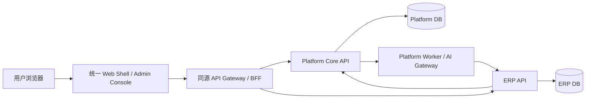

# 总体架构与数据安全

本文件定义**新平台自己的目标架构**。CRM、MES、ERP 是随后接入的平台应用，不是三个需要被合成一个后端或数据库的旧项目。架构先为未来多个行业应用建立稳定的公共契约，再用 ERP 验证契约是否足够。

## 1. 架构原则

1. 一个 Monorepo 管理平台、应用和共享契约；一个统一 Web/管理入口。业务应用仍是正常代码，拥有自己的业务模型、Service、迁移和测试。
2. 平台核心内部采用模块化单体，集中维护租户、身份、授权、应用启用、AI、审计等公共能力；每个业务应用是明确边界的应用运行单元。首期只有平台与 ERP，不拆出一串细碎微服务。
3. 共享云首先服务多个租户；客户专属部署使用同一代码与应用接入契约，通过部署配置替换数据库、对象存储、模型与域名。
4. 公共能力属于平台；行业语义属于行业层；采购、销售、库存、财务规则属于 ERP。领域边界按 [12 领域边界与协作契约](12-领域边界与协作契约.md)确定，只有实际重复且语义稳定的业务能力才提升为行业共享模块。
5. 不以“物理上只有一个数据库/进程”为复用目标。复用通过稳定接口、SDK、权限契约、UI Shell 与运维契约实现。



图中的 `ERP API` 是第一套应用。后续 CRM、MES、建筑应用以同样方式接入，不改写平台核心。`Platform DB` 与 `ERP DB` 可以由同一 PostgreSQL 集群承载，但使用不同数据库/凭据及迁移历史；应用不能直接访问平台库，平台不能直接修改 ERP 业务表。云端部署可分别扩容平台与应用。专属部署可打包平台及所需应用，不产生另一套业务代码。

## 2. 模块归属

| 模块 | 归属与首期职责 | 应用如何使用 |
| --- | --- | --- |
| Tenant / Identity / Session | 平台。企业、全局用户、成员关系、登录/退出、会话失效。 | ERP 接受平台认证上下文，不再维护独立登录系统。 |
| Organization / Permission | 平台保存组织、角色授权和权限目录；应用声明自己的动作并执行对象范围规则。 | ERP 声明 `purchase.confirm` 等动作；销售客户 owner 范围在 ERP Service 校验。 |
| App Registry / TenantApp | 平台保存代码原生应用的目录和租户启用状态。 | ERP 注册前台/后台入口、权限和能力；不提供通用对象/页面构建器。 |
| AI / Model Gateway / Task | 平台持有对话与操作编排、Provider 配置、模型调用、任务、用量、Tool 调度与审计规范。 | ERP 持有模块 AI 场景、提示词、业务 Tool、写入校验及操作回执。 |
| File / Knowledge | 平台提供鉴权存储、文档处理及按权限检索的公共接口。 | 应用声明文档所属业务对象和可见范围。ERP 首期的粘贴文字不能冒充已支持 PDF/OCR。 |
| Audit / Observability | 平台定义事件格式、集中查询、请求链路与用量；应用写入本地事务审计/Outbox。 | ERP 的库存、账款、权限敏感操作与 AI Tool 可追到人、租户、对象和请求。 |
| Integration / Notification | 平台提供凭据管理、Webhook/投递与失败重试的底层能力，在真实需求出现时实现。 | 具体 SKU 映射、收件人、业务模板和外部动作由应用/行业模块决定。 |
| UI Shell / Design System | 平台提供企业切换、应用切换、统一导航、状态与组件 token。 | ERP 提供自己的业务页面与管理子模块，注册到 Shell。 |

平台“先建设”指先定义并实现 ERP 接入所需的公共模块及契约。文件/知识、通知和具体 Connector 可以先有明确边界，实际功能由真实业务用例触发；不得为凑齐模块清单制作空页面或伪连接。

## 3. 应用运行单元与数据所有权

ERP 拥有客户、商机、产品 SKU、供应商、采购、销售合同、库存、应收应付和收付款等业务数据。ERP 的每个租户私有表包含 `tenant_id`；数据库使用独立凭据、迁移与备份。平台拥有 `User`、`Tenant`、`TenantMembership`、组织、角色授权、`TenantApp`、模型配置/用量和中央审计索引等平台数据。跨库只保存稳定 ID，不建立跨库外键。

ERP 业务事务必须在 ERP 数据库内闭合：例如一次分批入库同时更新订单、库存流水和应付；模型、平台或网关不得绕过 ERP Service 写表。跨平台/应用协作使用带幂等键的内部 API 或持久 Outbox/Inbox 事件；先保证本地业务事务成功，再可靠投递审计/通知。不要用同步双写假装跨库事务。

采购、销售、库存和财务首期是 ERP 上下文内的业务模块，不因名称不同就拆成跨服务事务。CRM 的“客户”和 ERP 的“客户”、MES 的“物料”和 ERP 的“产品”也不能因字段相似而提升为平台公共表；两者需要显式映射和字段级归属决定。具体上下文图、不变量和首个纵向切片见 [12 领域边界与协作契约](12-领域边界与协作契约.md)。

后续制造业 SKU 映射属于制造行业/应用集成语义，不属于平台通用产品模型。平台 Integration 只提供安全连接与投递能力。CRM、MES 分别拥有自己的业务数据，除明确授权的业务 API/事件外不互查数据库。

## 4. 请求、权限与服务间信任

1. 浏览器只访问同源 Gateway/BFF。用户会话由平台管理；每个请求在平台核验会话、租户成员状态、应用启用及动作授权。URL 的 `tenantKey` 只是选择器，不能作为授权证明。
2. Gateway 向 ERP API 传递服务端签名的短期 `RequestContext`，限定 `tenantId`、`userId`、`membershipId`、`appId`、动作授权、请求 ID、到期时间和受众。ERP API 验证签名、受众、时效与内部调用来源；拒绝浏览器自造的上下文头。
3. ERP Service 再按自己持有的记录核对 `tenant_id`、对象所有权/项目范围、状态和版本。平台授予动作不等于可以操作任意 ERP 对象。跨租户对象不得暴露存在性。
4. 降权、停用或移除成员后，Gateway 的**下一次请求**必须从当前成员状态重新授权；不能只依赖长期缓存的角色声明。异步任务执行前重新检查可执行性与对象权限。
5. 内部 API 不直接暴露公网；服务身份、签名密钥和数据库凭据由部署 Secret 管理并可轮换。

```ts
type RequestContext = {
  requestId: string;
  tenantId: string;
  userId: string;
  membershipId: string;
  appId: string;
  permissions: readonly string[];
};
```

平台权限目录由应用以版本化 Manifest 注册。平台管理员可以授予角色/应用访问；应用本身负责 `sales-owned-customer`、`purchase-state` 等领域规则。AI Tool 与人工入口使用同一上下文和 ERP Service，不能给 AI 额外的数据库或任意网络权限。

## 5. AI 与知识路径

平台提供 AI 聊天框；用户可在对话中选择有权应用和业务上下文，要求 AI 查询、分析或执行操作，也可从 ERP 单据/列表直接发起模块 AI。平台 AI Gateway 管理模型、Tool 调度、任务、计量与审计；ERP 验证对象权限，装配最小上下文并提供有明确输入、效果和幂等规则的读/写 Tool。AI 可以创建或修改业务对象，但实际写入必须由 ERP Service 执行并返回持久化结果；模型文本不能冒充执行成功。高影响动作先向用户展示对象、字段及后果并取得明确确认，执行时重新校验权限、状态和版本。金额、库存等事实由确定性业务代码计算。场景设计见 [11 AI 能力与业务嵌入规范](11-AI能力与业务嵌入规范.md)。

知识服务属于平台，但每条内容必须带租户、应用、业务对象/权限范围、来源与版本。检索前按权限缩小候选集合；平台不会因拥有统一知识索引而越权读取 ERP 的业务表。ERP 首期只启用已经真实验收的 AI 能力，模型失败不妨碍人工单据流程。

## 6. 部署与故障边界

共享云首期部署：统一 Web、Gateway/Platform API、Platform Worker、ERP API、Platform DB、ERP DB；初期两个数据库可以共用一个 PostgreSQL 实例。应用 API 与数据库是独立边界，方便后续独立扩容、迁移与专属部署。模型/Worker 故障时 ERP 人工流程可运行；身份/授权服务不可用时拒绝新的受保护请求，不能绕过权限放行。

专属部署交付同一组平台/应用镜像，按客户启用模块，用独立资源和 Secret 配置存储、模型、邮件、域名与备份。业务代码不得含某客户专属分支。真正的离线安装、SLA 和数据驻留要求在首个专属客户场景明确后另行验收。

## 7. 代码结构建议

```text
enterprise-ai-platform/
  apps/web/                      # 统一业务 Shell 与管理后台
  services/platform-api/         # 平台模块化单体与 Gateway/BFF
  services/platform-worker/      # AI/文档/异步任务
  services/erp-api/              # ERP 应用运行单元，接入时建立
  platform/                      # 租户、身份、授权、应用、AI、审计等模块
  business/erp/                  # ERP domain / API / web / admin / AI Tool
  packages/platform-sdk/         # 应用接入上下文与契约
  packages/ui/                   # 统一设计 token 与可复用组件
  infrastructure/               # 共享云与专属部署配置
  docs/
```

不提前创建 CRM、MES、建筑空模块。详细的应用接入清单见 [10 应用接入契约](10-应用接入契约.md)。
