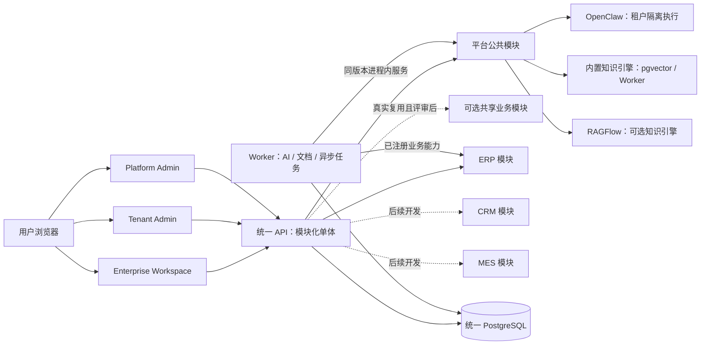

# 总体架构与数据安全

> 文档属性：功能契约。规则与验收要求不等于全部能力已实现或已发布，日期证据保留其环境。状态入口：[47](47-项目现状与文档维护.md)；公共UI：[ui/00](ui/00-公共UI规范.md)。

当前架构为三个独立前端、模块化API、PostgreSQL和Worker；已实现/本地/发布状态见 [47](47-项目现状与文档维护.md)。本文维护结构与安全边界，旧应用只作规则参考。

## 1. 统一技术架构

1. 一个 Monorepo、Enterprise Workspace/Tenant Admin/Platform Admin 三个独立前端、一个模块化后端 API、一个 PostgreSQL 数据库，以及独立 Worker。平台和业务应用是同一产品中的代码模块；业务 API 路由不意味着独立服务。D-016 新增 OpenClaw 执行实例；D-020 以内置 PostgreSQL + pgvector 为默认知识引擎，RAGFlow Cloud 保留可选外部接入（暂不本地部署）。
2. 后端先采用模块化单体。平台公共模块建设一次；ERP、CRM、MES 分别拥有自己的业务规则、表和测试，通过模块公开的应用服务协作。出现明确的扩容、合规或故障隔离需求时才评估拆分运行单元。
3. 共享云按租户隔离；未来专属部署使用同一代码、迁移和镜像，通过部署配置及应用启用状态决定提供哪些功能，不维护客户专属分叉。
4. 平台先建设 ERP 首客需要的租户、身份、稳定组织单元/成员归属、授权、代码应用注册、App Context、AI 执行、审计和运行基础。按 D-016 在首阶段建设完整文档知识产品并支持内置/RAGFlow；通知和通用集成仍按真实用例逐项建设。业务能力默认归应用；跨应用共享按 [14 准入规则](14-共享能力准入与模块公开契约.md) 评审。
   能力交付与企业内授权是两层操作：平台运营权限控制某租户获得哪些应用能力，租户管理员只能在已交付且已启用的范围内分配成员/组织访问。两类操作都由服务端校验并留审计；按 D-016 分别交付 Platform Admin、Tenant Admin，实际需要的 Agent/知识授权数据按 [24](24-首阶段新增能力与验收.md) 建立。
5. DDD 用于划分术语、数据所有者和不变量，不要求每个限界上下文拥有独立进程或数据库。详细边界见 [12 领域边界与协作契约](12-领域边界与协作契约.md)。

AI 控制层、Runtime、模型调用与内外部协议的边界以 [ADR-002](ADR-002-AI运行边界与外部协议.md) 为准。当前实现已具备可信应用注册、权限贡献与按请求解析的 `AiProviderRegistry`；下一套应用按 [10 接入清单](10-应用接入契约.md#新业务应用接入与验收清单d-029) 接入，这不改变单体部署或 ERP 业务所有权。当前实现与未来扩展的分层关系见该文图示。

平台的长期定位面向多行业，但行业能力按真实应用产生：业务应用拥有对象、规则和闭环；可评测的 Skill 与受控 Native Tool 先由首个应用拥有，第二个真实消费者出现后按 [14 准入规则](14-共享能力准入与模块公开契约.md)评审提升。Enterprise AI 是体验入口，不是新增 Agent 类型；ERP 首阶段的单 Agent 与 Runtime 边界见 [22](22-AI体验与首阶段Agent策略.md)。D-029 更新当前排期：平台与 ERP 六批工程交付已完成，D-039已选定电商CRM进入前置文档准备，实施范围按CRM索引确认。



图示是目标模块关系，不代表 CRM/MES 或共享业务模块已开发。Web、API、Worker 和数据库是首期部署单元；新增应用默认先作为同一代码与 API 中的模块开发。

## 2. 公共模块与业务模块

| 模块 | 统一能力或数据所有权 | 业务模块如何使用 |
| --- | --- | --- |
| Tenant / Identity / Session | 企业、用户、成员、登录、会话。 | ERP、CRM、MES 使用同一身份，不各建账号。 |
| Organization / Permission | 平台拥有稳定 `OrgUnit` 树和 `MembershipOrg` 关系、角色授予、应用启用与权限动作目录；岗位/矩阵组织按用例扩展。 | 业务模块声明动作，并校验组织范围内的对象所有权、状态和版本；项目级范围仍由所属业务定义。 |
| App Registry | 代码原生模块的导航、权限、后台与 AI 能力清单。 | 按租户启用应用；不生成任意业务表或表单。 |
| AI 控制层 / OpenClaw | 平台保有稳定会话/消息/动作 ID、上下文、Tool 授权、确认、回执、用量和审计；OpenClaw 承担 Agent/模型执行，其私有 ID 只保存在适配映射中。 | 业务模块提供场景、事实来源、读写 Tool 和应用命令；现有直连 Model Gateway 在迁移后退出客户可用主链。 |
| File / Knowledge / RAGFlow | 平台拥有原始文档、知识空间、文档/版本、Owner、权限、处理状态和稳定 Citation ID；内置或 RAGFlow 适配器处理解析、索引与检索，首阶段交付 Workspace 知识入口。 | 业务模块定义相关文档与业务对象关系；实时业务数据仍经 Native Tool 查询；外部索引可从平台原件重建。 |
| Audit / Notification | 首期统一审计格式、查询和请求链路；投递渠道按用例建设。 | 业务写入与必要的审计/Outbox 在同一事务中提交，业务提醒规则由应用拥有。 |
| Customer / Opportunity（ERP 首期） | ERP 自有客户、商机的稳定 ID、状态、权限和写入规则。 | CRM 建设时核对客户关系及商机语义，Q-003 决定引用、映射或共享提升。 |
| Product / Material（ERP 首期） | ERP 自有商品、价格及库存关联；不预建统一物料目录。 | MES 建设时核对物料、单位与版本，Q-004 决定引用、映射或共享提升。 |
| ERP / CRM / MES | 各自的业务流程、不变量、扩展数据和对象权限。 | 经公开应用服务调用共享模块或其他领域模块；不跨模块直接写表。 |
| UI Shell / Design System | 企业/应用切换、导航、状态和组件 token。 | 业务页面注册进同一 Shell，复用组件。 |

共享客户、商机和商品/物料不作为平台 P0 必建表。文件、通知和外部连接按真实用例逐步实现，不创建假入口。ERP 首期模型属于 ERP；[Q-003/Q-004](00-文档索引与决策记录.md#待确认的决策) 在 CRM/MES 跨应用协作前决定是否关联或提升共享，不把旧三套表机械拼接。

### 稳定组织关系

平台 `OrgUnit` 至少有 `id`、`tenantId`、`parentId`、名称、启停状态和版本；`MembershipOrg` 将 `Membership` 与同租户组织单元关联，可标记一个主要归属。开通租户时建立根组织单元，成员可先归属根节点。父子不能跨租户或成环；停用/移动组织时处理已有成员和对象范围。组织关系变化在下一次受保护请求和 AI Tool 执行时生效。部门/下级范围由平台提供树关系，CRM、ERP 等应用仍定义自己的记录可见性和负责人规则；内部 `OrgUnit` 与外部客户/供应商的 Party 身份绝不混用。

## 3. 数据与事务

统一 PostgreSQL 由同一发布流程管理迁移和备份；表按模块归属命名，每张表有唯一写入所有者，必要时可用数据库 schema 辅助隔离。每个租户私有业务表都包含 `tenant_id`，查询与唯一约束均按租户处理。ERP 客户、商机和商品先持有自己的稳定 ID；若 Q-003/Q-004 后来确定为同一业务对象，共享提升须附迁移与历史引用方案；语义不同则经明确关系表关联。

控制器、AI Tool 和其他模块不能绕过拥有者的应用服务修改业务表。采购确认、分批入库、库存流水/余额及应付等必须同时成功的操作，在统一数据库中使用一个事务；无需为了模块边界引入跨库同步双写。跨模块调用优先用明确的应用服务接口；通知、索引和第三方投递等允许延迟的副作用通过事务 Outbox 与幂等 Worker 处理。

平台 AI 只依赖 Tool 注册与执行契约，ERP 等应用注册具体 Tool 实现；平台代码不得导入业务模块的内部 Repository。首期同进程原生调用；MCP 仅作为未来外部适配协议，不能用于本系统内部模块通信。公开契约有助于将来调整部署，但同库事务不能通过把本地调用换成远程 API 原样保留。

## 4. 请求、权限与 AI

浏览器只访问同源 API。服务端从会话、当前租户成员/组织关系和 `TenantApp` 启用状态生成 `AppContext` 与 `RequestContext`，每次受保护请求重新确认授权；URL、请求体、会话历史和模型输出中的 `tenantId`、`userId`、`appId`、角色均不能作为授权来源。同进程模块接收服务端创建的上下文，不需要为虚构的服务间调用签发内部签名。Worker 执行敏感任务时重新核验当前权限、应用启用和对象状态。

```ts
type AppContext = {
  appId: string;       // 已注册且对当前租户启用的业务应用；平台管理入口使用保留值 platform
  tenantAppId?: string; // 业务应用必须有 TenantApp；平台管理入口无此值
};
type RequestContext = {
  requestId: string;
  tenantId: string;
  userId: string;
  membershipId: string;
  app: AppContext;
  roles: readonly string[];
  permissions: readonly string[];
};
type AIExecutionContext = {
  request: RequestContext;
  sessionId: string;
  currentResource?: { appId: string; type: string; id: string; version?: number };
};
```

`appId` 是权限、AI Tool、知识检索、审计和用量的一等上下文，不能只靠路由字符串推断。平台管理入口使用保留的 `platform` 上下文并检查平台权限；切换到 ERP 等业务应用必须重新校验 `TenantApp`。`roles` 和 `permissions` 是当前请求服务端计算的结果，不是可跨请求沿用的授权凭据；`resourceScope` 由所属业务模块对具体对象/动作结合当前组织归属计算，不做一份万能可写的通用字段。AI 每次调用 Tool 时按目标应用重新构造有权 `RequestContext`，校验当前资源所属应用、版本和权限，不能以对话所选应用越权。应用的动作授权由平台检查；对象归属、状态、版本、数量和金额由所属业务模块检查。AI 聊天和模块 AI 调用与页面相同的业务命令，写入成功只以已提交的业务回执为准；高影响动作展示对象、字段及后果并取得明确确认。模型不能直接写 SQL，也不能用文本冒充操作成功。

知识的 `RetrievalContext` 复用同一租户、成员、App 和当前资源身份，Provider 在检索前执行对象权限过滤；`Citation` 返回可核对的来源、对象/文档 ID、版本及定位。具体契约见 [11 AI 能力规范](11-AI能力与业务嵌入规范.md)。内置知识引擎已有日期验证记录，RAGFlow Cloud仍按D-022暂缓；接口定义本身不证明某个引擎已接通。

## 5. 部署与代码结构

首期共享云部署三个前端、统一 API、Worker、PostgreSQL、按租户隔离的 OpenClaw Gateway、内置 pgvector 知识能力及可选 RAGFlow Cloud（D-020，暂不本地部署），并配置受控文档存储。API 与 Worker 使用同一代码版本和数据迁移；可以独立扩容 Worker，但不把 ERP 单独部署。OpenClaw/RAGFlow/Worker 故障时人工 ERP 流程仍可运行，AI/知识功能显示真实故障；身份/授权不可用时拒绝新的受保护操作。隔离与部署验收见 [24](24-首阶段新增能力与验收.md)。

专属部署交付同一组镜像和迁移，使用独立资源及 Secret 配置数据库、存储、模型、邮件、域名和备份；租户与权限规则保持一致。离线交付、SLA 和数据驻留在有客户需求时单独验收。

```text
enterprise-ai-platform/
  apps/web/                    # Enterprise Workspace 与 ERP 业务
  apps/admin/                  # Tenant Admin（D-016 新增目标）
  apps/platform-admin/         # Platform Admin（D-016 新增目标）
  apps/api/                    # 一个 HTTP API，内部按领域模块组织
    src/modules/platform/      # 身份、权限、应用、AI、知识、审计
    src/modules/erp/           # ERP 自有业务命令、查询、API、AI Tool
  apps/worker/                 # AI、文档和可靠异步任务
  packages/contracts/          # 实际被使用的 API schema 与模块公开接口
  packages/ui/                 # 设计 token 与无业务语义的复用组件
  infrastructure/              # 共享云与专属部署配置
  docs/
```

CRM、MES、建筑和 Shared Business 模块在对应阶段开发或经共享评审后创建，不提前建空目录。业务 UI、SDK 和行业共享包也以真实复用为前提。模块开发规则见 [10 应用模块契约](10-应用接入契约.md)。


## D-029 持久任务和运维授权

- Worker 的知识处理、模型任务、消息投递、提醒、经营事件、持续业务任务和应用事件使用独立单在途调度通道。业务任务和应用事件按租户轮转，每次选择每租户一个就绪任务；不承诺多实例全局配额的绝对公平性。
- BusinessTask/Step、ApplicationOutbox、CommandReceipt 和 ObjectLink 持久化。步骤写入使用任务租约围栏；中断后复用业务回执；取消与新步骤并发时不得恢复已取消步骤。
- 套餐权益固定到订阅快照。配额由服务端事务锁处理席位、月度 AI、任务和知识原文版本容量；月份采用 UTC 月首。没有订阅的现有企业保持未配置额度状态。
- Token 用量来自执行组件，单价在预留时固定；缺少用量或价格标记计费信息不完整。费用是平台配置价格的用量估算，不代表上游供应商账单。
- 支持访问由指定运营账号申请、企业有效管理员批准，限定 health/audit/tasks 只读范围，最长 8 小时，可即时撤销并记录审计；不开放伪装登录或任意业务数据访问。

## 共享身份与界面（D-044/D-045）

系统账号为可选唯一User.account，旧邮箱保持兼容；注册不分配平台运营权限，创建企业只分配本企业管理员。Tenant.selfServiceOwnerId限制重复自助创建，邀请和会话撤销仍受服务端校验。数据变更及迁移见46。

公共UI属于平台前端能力，规则见 [ui/00](ui/00-公共UI规范.md)。业务页复用组件，业务字段与状态归应用；三个前端独立构建/发布，共用后端、身份和领域服务。

`tenant_admin`/`platform_admin`为管理AI保留域：前者需本企业管理员，后者需运营身份及服务企业管理员；两者只读，任务/SSE/终态重鉴权，业务注册器拒绝这两个App ID。不会将管理域当成CRM业务应用或绕过其TenantApp授权。
