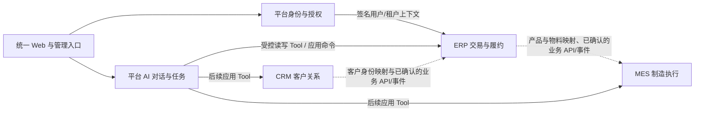

# 领域边界与协作契约

状态：新平台开发前的目标设计。用领域驱动设计（DDD）先厘清业务语言、数据所有者和业务规则，再决定模块与接口；本文件不声称旧系统已经按此结构实现。这里的“限界上下文”是业务语义与模型边界，不等于一个进程、一张表或一套数据库。首期保持平台核心和 ERP 两个后端运行单元。

## 1. 上下文图

实线表示目标平台接入方式；虚线表示后续接入时才落地的业务协作，**不表示当前已打通**。平台身份、应用注册和 AI 运行时服务于所有应用；各应用拥有自己的业务事实。跨上下文只交换稳定 ID、经过筛选的业务数据和已完成的事实，不共享 ORM 模型或直接查询对方数据库。

## 2. 上下文与数据所有者

| 上下文 | 统一语言与负责的事实 | 不负责的事实与规则 |
| --- | --- | --- |
| 平台身份与授权 | `User`、`Tenant`、`Membership`、组织、权限动作、会话；成员是否有权使用某应用。 | 客户归属、采购状态、库存余额等应用内对象规则。 |
| 平台应用目录 | `App`、`TenantApp`、Manifest/契约版本、入口与启用状态。 | 动态生成 ERP 单据或解释业务字段。 |
| 平台 AI 对话与任务 | 对话、消息、AI Action/Task、模型配置、用量、Tool 调度和操作回执索引。 | 采购单、客户、工单等业务对象的最终状态；不能代替应用确认写入成功。 |
| ERP 交易与履约 | ERP 客户与商机、产品 SKU、供应商、采购单、销售合同、库存单据与余额、应收应付及收付款。内部按客户/目录、采购、销售、库存、财务模块分工。 | CRM 线索转化与客户服务流程；MES 物料、BOM 和报工。 |
| CRM 客户关系 | 线索、CRM 客户/联系人、商机、跟进、服务过程及其负责人范围。 | ERP 合同、库存与账款；“CRM 客户”不自动等于“ERP 客户”。 |
| MES 制造执行 | MES 物料、BOM 版本、生产计划、工单、报工及审核。 | ERP 商品售价、采购成本、合同履约和应收应付。 |

日志、存储、通知和设计系统是共享技术能力，不因此成为所有业务事实的所有者。ERP 首批接入时，平台只搬走旧 ERP 自建的登录、租户与通用模型配置职责；原采购、库存、销售和财务规则仍属于 ERP。CRM 与 MES 接入时按相同方法做上下文映射。

## 3. 必须守住的业务不变量

| 所有者 | 关键不变量 | 命令与事务边界 |
| --- | --- | --- |
| 平台身份与授权 | 停用成员、撤销权限或停用应用后，后续请求不得沿用旧授权；每租户至少保留一位有效管理员。 | 平台身份/授权命令；应用请求重新核验当前成员和应用状态。 |
| ERP 采购 | 采购单只能按允许的状态转换；确认检查版本；分批实收量不得超过剩余量。 | `ConfirmPurchase`、`ReceivePurchase` 由 ERP 应用服务执行。 |
| ERP 入库与应付 | 一次实收入库对应采购单进度、库存单据/流水、库存余额及应付金额的一致变化；失败整批回滚。 | ERP **同一数据库事务**。采购、库存、财务是内部模块，首期不得为追求形式上的服务拆分破坏该事务。 |
| ERP 销售与出库 | 合同确认检查状态和版本；分批出库不得超发，库存不足时不能形成部分成功的账款结果。 | ERP 本地事务更新合同、库存流水/余额和应收。 |
| ERP 财务 | 收付款金额大于零且不超未结余额；同一账款的参考号不能重复。 | ERP 账款命令和数据库约束共同保证。 |
| CRM 线索转化 | 线索必须处于允许转化的状态；审批配置、负责人/组织范围和幂等键同时生效，同一线索不能重复转化。 | CRM 本地事务生成 CRM 客户/联系人/商机和审计。 |
| MES BOM 与报工 | 发布 BOM 前检查版本、有效物料及循环；审核报工时禁止自审和超出工单计划量。 | MES 本地状态转换、版本校验和审计。 |
| 平台 AI Action | 对话只能调用已注册且当前用户有权的 Tool；业务“成功”须来自所属应用的持久化回执。高影响写入先确认，执行前再次校验。 | 平台负责调度与回执索引；应用命令拥有业务事务。 |

旧应用的采购、库存、CRM 转化和 MES 报工规则参考了当前代码；平台身份和 AI Action 是新平台目标。迁入时仍需用代码、迁移和验收记录逐项复核。AI 的提取或推理只能准备输入，不能替代这些不变量。

### 建议的聚合与事务关系

| 聚合候选 | 聚合内约束 | 跨聚合协作 |
| --- | --- | --- |
| `PurchaseOrder` 与行项目 | 状态、版本、每行订购量/累计实收量。 | `ReceivePurchase` 应用命令在 ERP 本地事务中协调 `StockDocument`、`InventoryBalance` 和 `Payable`；不把整个 ERP 做成一个巨型聚合。 |
| `SalesContract` 与行项目 | 状态、版本、每行合同量/累计出库量。 | `ShipContract` 在 ERP 本地事务中协调库存与 `Receivable`。 |
| `Receivable`/`Payable` 与付款记录 | 应结余额、已结金额、重复参考号。 | 付款命令复核当前余额并写审计；数据库唯一约束作最后防线。 |
| CRM `Lead` | 负责人、状态、转化资格和版本。 | 转化命令在 CRM 本地事务中建立/关联 CRM `Customer`、`Contact`、`Opportunity`，保证幂等。 |
| MES `Bom` 与行项目、`WorkOrder` 与报工 | BOM 版本/循环校验；报工累计量与审核状态。 | 发布 BOM、审核报工由 MES 应用命令协调相关记录。 |

这些是开发时验证的候选边界，不是要求把旧 Prisma 表逐一包装成类。跨多个聚合但要求原子性的 ERP 入库仍可使用同一数据库事务；跨应用事件只用于允许最终一致的协作。

## 4. 相同名称不等于同一模型

- **CRM 客户与 ERP 客户**：先分别保持各自 ID、字段和生命周期。CRM 关注线索转化、关系与服务；ERP 关注交易、合同与账款。关联时建立租户内显式映射和来源记录，不按名称或邮箱自动合并。字段级主数据归属、同步方向和冲突处理须在 CRM 接入前确定。
- **ERP 产品与 MES 物料**：ERP SKU 参与采购、销售、价格与库存；MES 物料参与 BOM、单位、版本与工单。建立显式产品—物料映射并标注单位换算、有效期和失效处理；不能仅凭 SKU 文本相等推断为同一物品。映射与字段级权威来源须在 MES 接入前确定。
- **全局用户与应用业务负责人**：平台拥有用户、租户成员和授权；应用保存稳定用户 ID 引用，并根据本应用规则解释 `owner`、`assignee`、`reviewer`。旧 ID 迁入须有映射，不能按邮箱静默合并。

## 5. 跨上下文协作契约

| 交互 | 方式 | 一致性与责任 |
| --- | --- | --- |
| 平台 → 应用授权 | 每次请求产生短期签名上下文；应用验证并再次检查业务对象范围。 | 权限变化影响后续请求；异步任务执行时重新授权。 |
| AI 聊天/模块 AI → 应用 | 已注册的查询或命令 Tool → 应用服务 → 领域规则/数据库。 | Tool 记录输入 schema、权限动作、是否需确认、幂等键和业务回执；聊天不能直写表。 |
| 应用内部模块 | 同一应用服务内的命令/查询与本地事务；必要时有内部领域事件。 | 必须原子完成的 ERP 出入库与账款仍在本地事务内。 |
| 应用 → 平台审计/通知 | 本地事务写审计和 Outbox，提交后异步投递；平台建统一索引。 | 投递失败可重试，不回写或伪造业务成功状态。 |
| CRM ↔ ERP、ERP ↔ MES | 经确认的业务 API 或 Outbox/Inbox 集成事件，入口处做模型翻译。 | 消费者按 `eventId` 幂等处理；失败可补偿/重放，不共享跨库事务。首批 ERP 不假设这些连接已存在。 |

内部领域事件只在应用内表达已发生的状态变化；发布给其他应用的集成事件需版本化、最小化字段。标准信封至少包含 `eventId`、`eventType`、`schemaVersion`、`tenantId`、`sourceApp`、`aggregateId`、`aggregateVersion`、`occurredAt` 和 `requestId`。事件内容不得直接镜像数据库整行或暴露不必要的敏感字段。映射表与 Inbox 属于接收方或明确的集成模块，不属于平台通用业务对象引擎。

## 6. ERP 首个纵向切片：采购确认到分批入库

1. **输入**：页面或 AI 聊天发出“确认采购单”命令。平台核验租户、成员、ERP 启用和动作授权；聊天中这一高影响动作先展示具体单据并获得确认。ERP 校验供应商、明细、状态、版本和操作者对象范围。
2. **确认**：ERP 采购模块把草稿转为已确认，版本递增；审计与必要的 Outbox 记录在 ERP 本地事务中提交。返回已提交的单据状态和版本。
3. **分批入库**：ERP 收到指定采购行及实收数量，核对未收余额和版本；在同一事务中更新采购进度、库存单据/流水、库存余额及应付。若超收、并发冲突或任一写入失败，整体回滚。
4. **结果**：业务 Service 返回真实采购单、入库单和应付状态；页面或聊天据此展示回执与对象链接。AI 模型只做资料提取、差异解释或命令参数准备，不能自己推算并覆盖库存与账款。
5. **验证**：至少覆盖两次分批入库、重复请求、超收、并发版本冲突、跨租户/越权、模型或 Tool 超时，以及审计/Outbox 投递失败后的重试。核对订单、库存流水/余额和应付金额一致，且不存在重复入库。

这个切片用于证明平台授权、AI Tool、ERP 业务命令与本地事务能协同工作；不能据此宣称 CRM/MES 集成已经完成。

## 7. 实施规则

1. 每个新模块先写清统一语言、对象所有者、状态转换和不变量，再设计数据库表、API、Tool 与 UI。任何跨应用字段先确定权威来源与映射，不先建“全平台 Customer/Product”表。
2. 复杂状态和事务优先用领域对象/规则函数、应用命令和按聚合设计的仓储接口隔离；`Money`、`Quantity`、业务版本等有明确约束时可用值对象。简单配置或只读查询不必机械创建四层类与每表一个 Repository。
3. 应用服务编排事务与外部协作，领域规则决定状态是否合法；控制器和 AI Tool 只是入口，不能复制另一套采购、库存或账款规则。
4. 测试围绕不变量、权限、并发、回执与跨上下文契约；迁移旧应用时以现有代码和验收记录为事实来源，不因重构更改已验收的金额、数量或状态规则。
5. 领域边界变更需更新本文件、[03 总体架构](03-架构与数据安全.md)、[10 应用接入契约](10-应用接入契约.md)及相关功能验收。CRM/MES 的字段级主数据归属在各自接入前另行确认，不阻挡平台和 ERP 首期开发。
