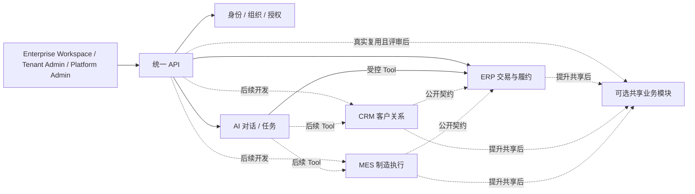

# 领域边界与协作契约

> 文档属性：功能契约。规则与验收要求不等于全部能力已实现或已发布，日期证据保留其环境。状态入口：[47](47-项目现状与文档维护.md)；公共UI：[ui/00](ui/00-公共UI规范.md)。

2026-10-14 D-039：电商 CRM 的当前领域方案见 [CRM 领域边界](crm/02-平台接入与领域边界.md)。下文 CRM 线索/商机是旧 B2B 参考例子；新应用以消费者、订单分析、分群和运营任务为自己的业务事实，正式尚未实现。

状态：新平台开发前的目标设计。DDD 用于明确统一语言、数据所有者和不变量；限界上下文是业务语义边界，不等于独立服务或数据库。ERP、CRM、MES 都在一个模块化后端和一个数据库中从零开发；旧系统只供功能与规则参考。

## 1. 目标上下文图

所有模块处于同一产品、后端和数据库。实线表示首批目标关系，虚线表示后续候选关系，不表示已经交付或必须建共享业务模块。模块之间通过公开应用服务和稳定 ID 协作，不直接修改其他模块拥有的表；归属和提升规则见 [14 共享能力准入](14-共享能力准入与模块公开契约.md)。

## 2. 业务事实与所有者

| 模块 | 负责的事实 | 不负责的事实 |
| --- | --- | --- |
| 平台身份与授权 | `User`、`Tenant`、`Membership`、稳定 `OrgUnit`/`MembershipOrg`、会话、权限、AppContext 和应用启用。 | 采购状态、客户跟进和库存余额。 |
| 平台 AI / 文件 / 审计 | 对话、Action、任务、模型用量、文件权限、审计查询及 Tool 调度。 | 业务对象的最终状态和金额数量。 |
| 共享业务模块（以后可选） | 第二个真实应用出现相同业务事实并通过评审后，接管明确的最小共享事实与唯一写入 Owner。 | 不预定客户、商机或商品统一表。 |
| ERP | 首期客户、商机、商品、供应商、采购、销售合同、库存单据与余额、应收应付及收付款。 | CRM 线索、服务过程；MES BOM 与报工。 |
| CRM | 后续线索、客户关系、联系人、跟进、服务过程、商机及负责人范围；与 ERP 同名对象的关联按 Q-003 决定。 | ERP 合同、库存和账款。 |
| MES | BOM 版本、生产计划、工单、报工和审核；必要的物料生产扩展。 | ERP 售价、采购成本、合同履约和账款。 |

共享业务事实不能靠旧系统表名推断。[16 ERP/CRM 模型评审](16-ERP与CRM客户商机模型评审.md)已比较旧客户、商机、联系人、供应商和内部组织的语义。ERP 首期的客户、商机和商品先在 ERP 建模；CRM/MES 开发时若指向同一事实，可通过 ERP 公开契约引用稳定 ID，或经评审提升共享。若是不同事实，建立明确关联；[Q-003/Q-004](00-文档索引与决策记录.md#待确认的决策) 在跨应用协作前关闭，不以重复表名或相同 SKU 自动联动。

## 3. 必须守住的业务不变量

| 所有者 | 关键不变量 | 命令与事务边界 |
| --- | --- | --- |
| 平台身份与授权 | 停用成员、撤销权限或停用应用后，下一次受保护请求不得沿用旧授权；每租户至少一位有效管理员。 | 平台命令与统一 API 的当前授权。 |
| ERP 采购 | 采购单按允许状态转换；确认检查版本；分批实收不能超过剩余量。 | `ConfirmPurchase`、`ReceivePurchase` 由 ERP 应用服务执行。 |
| ERP 入库与应付 | 一次入库同时更新采购进度、库存单据/流水、余额及应付；失败整体回滚。 | 统一数据库中的**同一个事务**，不按模块拆散。 |
| ERP 销售与出库 | 合同确认检查状态和版本；库存不足不能产生部分成功的应收。 | ERP 命令在同库事务内协调库存和应收。 |
| ERP 财务 | 收付款金额大于零、不超未结余额，同一账款参考号不重复。 | ERP 命令与数据库约束。 |
| CRM 线索转化 | 状态、负责人、权限、版本和幂等同时校验，不能重复转化。 | CRM 命令在同库事务中写入自有对象；需建立 ERP 交易客户时，经 Q-003 确定的公开命令或关联规则协调。 |
| MES BOM 与报工 | 发布 BOM 检查版本、有效物料和循环；审核报工禁止自审及超计划量。 | MES 命令和事务。 |
| 平台 AI Action | Tool 必须已注册且操作者当前有权；成功只能来自业务命令的持久化回执。 | 平台调度，所属业务模块执行。 |

这些是不变量候选，来源包括旧应用代码和文档；在新需求及真实客户样本验证后确定，不自动复制旧数据库设计。AI 可以准备输入和解释结果，不能替代确定性数量、金额或状态规则。

### ERP 首批聚合与事务候选

| 聚合候选 | 聚合内约束 | 跨聚合协作 |
| --- | --- | --- |
| `PurchaseOrder` 与行项目 | 状态、版本、订购量/累计实收量。 | `ReceivePurchase` 命令在同一事务协调库存与应付。 |
| `SalesContract` 与行项目 | 状态、版本、合同量/累计出库量。 | `ShipContract` 命令在同一事务协调库存与应收。 |
| `InventoryBalance` 与库存流水 | 余额不可被并发覆盖，流水可追溯。 | 出入库与盘点命令更新。 |
| `Receivable`/`Payable` 与付款记录 | 未结余额、已结金额、重复参考号。 | 收付款命令复核当前余额并写审计。 |

按业务规则选聚合，不要求把每张旧 Prisma 表包装成类。简单查询和配置不必机械套用四层类结构。

## 4. 模块协作

| 交互 | 方式 | 一致性与责任 |
| --- | --- | --- |
| HTTP / AI → 业务模块 | 统一 API 生成可信 `AppContext`/`RequestContext`；入口检查租户、当前应用和动作，业务模块检查组织/对象范围和状态。 | AI、页面和 API 使用同一应用命令；Tool 执行时重新授权。 |
| 业务模块 → 其他所有者或经评审共享的模块 | 通过拥有者的公开查询/命令接口，不直接写对方表。 | 同一业务操作确需原子提交时使用同库事务。 |
| ERP ↔ CRM / ERP ↔ MES | 同进程的公开应用服务接口与明确的数据所有权；异步副作用才用事件。 | 不因模块名称不同就制造远程 API、双写或最终一致性。 |
| 业务写入 → 审计/通知 | 必要审计与业务写入同事务；通知/搜索等副作用经 Outbox 和 Worker 投递。 | 投递失败可重试，不把未完成副作用伪报为完成。 |
| 外部系统集成 | 经授权的版本化 API/Webhook/事件。 | 只为实际接通并验收的第三方连接声明能力。 |

内部领域事件表达本地状态变化；对外集成事件需要版本、最小字段、租户、对象 ID、时间和 request ID，消费者按事件 ID 幂等处理。不要为了将来可能拆服务而提前给每个领域建独立数据库。

## 5. ERP 首个纵向切片：采购确认到分批入库

1. 页面或 AI 聊天发出“确认采购单”命令。统一 API 核验租户、成员、ERP 启用和动作授权；高影响聊天动作先显示具体单据并取得确认。ERP 校验供应商、明细、状态、版本和对象范围。
2. ERP 采购模块把草稿转为已确认并递增版本；审计在同一事务提交。
3. 分批入库命令核对未收余额和版本，在同一数据库事务中更新采购进度、库存流水/余额及应付；超收、并发冲突或任一写入失败则整体回滚。
4. 业务命令返回已提交的采购单、入库单和应付状态；页面或聊天以真实回执展示对象链接。模型不自行计算并覆盖库存与账款。
5. 测试覆盖两次分批入库、重复请求、超收、并发、跨租户/越权、模型或 Tool 超时及审计/通知投递失败后的重试。

此切片验证统一平台公共模块、ERP 业务模块、AI Tool 和同库事务协作，不代表 CRM/MES 已开发。

## 6. 实施规则

1. 每个新模块先明确术语、所有者、状态转换和不变量，再设计表、API、Tool 与 UI。ERP 首期拥有客户、商机和商品；经 Q-003/Q-004 与 [14 准入规则](14-共享能力准入与模块公开契约.md) 确定确属同一业务事实后，才定义跨应用共享字段与迁移。
2. 应用服务负责事务和模块协作，领域规则决定状态是否合法；控制器和 AI Tool 只是入口，不能复制另一套业务规则。
3. 写入只能通过拥有者模块，模块接口和表归属由代码结构及测试约束。需要原子性时使用同库事务；允许延迟的副作用才用事件。
4. 旧应用用于功能对照和发现边界；新平台功能、数据和真实模型都必须重新验收。领域边界调整时同步更新 [03 总体架构](03-架构与数据安全.md)、[10 应用模块契约](10-应用接入契约.md)和功能验收。

## D-019 新增对象归属

报价、原批次退货、仓库与余额、期初批次、预收预付、往来发生流水、客户价格和业务审批设置归 ERP；邀请/账号恢复归共享身份模块。库存、成本、账款与业务审计须在同库事务中落地。OpenClaw/RAGFlow 仍通过稳定适配器接入，不持有 ERP 交易规则。具体规则见 [30](30-ERP客户完整性优化.md)。

## 2026-10-23 MES接入澄清（D-057）

旧段落中的后续应用与“仅ERP”属于原阶段设计。当前电商CRM已发布，MES在工作区实现，状态见47。MES物料目录、BOM、计划、工单和报工归MES所有；同SKU不自动关联ERP商品或库存。本期没有真实ERP-MES协作契约，不提升共享物料域、不写ERP表；已有通用平台能力复用，应用只公开受权对象Reader和确认后创建草稿的命令。见[mes/02](mes/02-数据与接口契约.md)。
