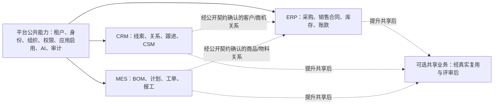

# 三应用业务能力清单与领域归属（开发前盘点）

> 文档属性：参考评审。旧应用/原始规划用于追溯，当前决定与新电商CRM按对应索引。状态入口：[47](47-项目现状与文档维护.md)；公共UI：[ui/00](ui/00-公共UI规范.md)。

状态：2026-09-29 的**旧项目只读盘点与新项目设计输入**；用户已确认新 ERP 按旧 ERP 当前已实现功能开发。本文件不表示新平台已实现这些能力，也不授权迁入旧代码或旧数据库。建设顺序仍为平台 → 新 ERP → 新 CRM → 新 MES → 架构复盘 → 建筑行业应用。

开发时以 [17 ERP 功能追踪矩阵](17-ERP功能追踪矩阵.md)逐项核对；旧 ERP/CRM 同名客户和商机的专项比较见 [16 模型评审](16-ERP与CRM客户商机模型评审.md)，Q-003 的真实数据同一性仍待定。

## 1. 证据口径

本次逐应用阅读 `AGENTS.md` 指向的需求与验收文档，并核对当前控制器、服务、Prisma 模型/迁移和已有 HTTP 测试。以下“有实现”表示工作区代码与数据结构存在对应路径；“历史本地验证”表示旧项目的实施记录或测试脚本给出过本地结果，**本次没有重跑测试、连接生产库或验证真实客户数据**。新平台的范围和验收必须重新确定。

| 来源 | 需求/验收 | 当前代码与数据 |
| --- | --- | --- |
| 旧 ERP | [产品需求](../../existing-business-apps/apps/electronics-erp/docs/01-产品需求.md)、[实施验收](../../existing-business-apps/apps/electronics-erp/docs/04-实施验收记录.md) | [API](../../existing-business-apps/apps/electronics-erp/backend/src/erp.controller.ts)、[业务服务](../../existing-business-apps/apps/electronics-erp/backend/src/erp.service.ts)、[库存服务](../../existing-business-apps/apps/electronics-erp/backend/src/stock.service.ts)、[模型](../../existing-business-apps/apps/electronics-erp/backend/prisma/schema.prisma)、[分批测试](../../existing-business-apps/apps/electronics-erp/backend/tests/partial-stock-flow.mjs) |
| 旧 CRM | [产品需求](../../existing-business-apps/apps/sales360-crm/docs/02-产品需求.md)、[实施验收](../../existing-business-apps/apps/sales360-crm/docs/09-实施与验收记录.md) | [CRM API](../../existing-business-apps/apps/sales360-crm/backend/src/crm.controller.ts)、[服务 API](../../existing-business-apps/apps/sales360-crm/backend/src/csm.controller.ts)、[业务服务](../../existing-business-apps/apps/sales360-crm/backend/src/crm.service.ts)、[模型](../../existing-business-apps/apps/sales360-crm/backend/prisma/schema.prisma)、[核心测试](../../existing-business-apps/apps/sales360-crm/backend/tests/core-flow.mjs) |
| 旧 MES | [产品需求](../../existing-business-apps/apps/mes/docs/01-产品需求.md)、[实施验收](../../existing-business-apps/apps/mes/docs/04-实施验收记录.md) | [API](../../existing-business-apps/apps/mes/backend/src/mes.controller.ts)、[业务服务](../../existing-business-apps/apps/mes/backend/src/mes.service.ts)、[BOM 服务](../../existing-business-apps/apps/mes/backend/src/bom.service.ts)、[模型](../../existing-business-apps/apps/mes/backend/prisma/schema.prisma)、[BOM 测试](../../existing-business-apps/apps/mes/backend/tests/bom-flow.mjs) |
| 共用现状 | [AI 实施规划](../../existing-business-apps/docs/06-AI能力实施规划.md)、[三应用交付检查](../../existing-business-apps/docs/07-三应用交付体验检查.md) | 三套独立 `ai.controller.ts`/`ai.service.ts` 与独立 `AiConversation`、`AiProviderSettings` 表 |

旧项目的历史本地构建和测试记录不能证明当前生产环境已完成业务写入、真实模型质量、外部办公平台连接或新平台能力。

## 2. 旧应用业务能力清单

### ERP：交易与履约

| 能力 | 代码/数据核对结果 | 历史本地验证与新项目取舍 |
| --- | --- | --- |
| 客户、商机、产品 SKU、供应商 | 有相应模型、创建/查询接口；客户、产品、供应商有编辑/停用接口。ERP 客户带交易编号、负责人；商机是轻量阶段与预计金额。 | 旧项目对相关 CRUD 和权限做过本地验收；新 ERP 自有模型须重新设计并验收，与 CRM 的关系在 Q-003 关闭。 |
| 采购单确认与分批入库 | `PurchaseOrder`/`PurchaseLine`、确认和 `receive` 命令存在；按行实收、版本、入库单、库存流水和应付由本地事务协调。 | 分批测试覆盖超收、重复入库单号、过期版本、事务回滚；这是新 ERP 首个纵向切片的优先参考。 |
| 销售合同确认与分批出库 | 合同/行项目、客户/可选商机引用、确认和 `ship` 命令存在；库存不足与超发应拒绝，出库产生应收。 | 分批测试覆盖两批出库、库存不足回滚和应收累计；按 D-008 纳入新 ERP 首客范围。 |
| 库存台账与盘点 | 库存余额、流水、出入库/盘点单模型及分页接口存在；盘点检查并发变化，产品可设低库存阈值。 | 旧项目本地验收含盘点差异与分页；当前没有多仓、批次/序列号、退货和质检。 |
| 应收应付与收付款 | `Receivable`、`Payable`、`Payment` 模型及收付款接口存在；金额、余额、重复参考号受服务和唯一约束保护。 | 旧项目测试了超额、分次付款和重复参考号；税票及自动付款不在旧实现。 |
| AI 辅助 | 有上下文聊天、履约分析、粘贴文字提单、确定性缺料建议和模型配置代码。 | 旧聊天只回答，不调用业务写 Tool；粘贴文字提取仅回填待确认表单，不支持文件/OCR。真实模型质量未验收。新平台的可执行聊天须另行设计和验收。 |

### CRM：线索、关系与服务

| 能力 | 代码/数据核对结果 | 历史本地验证与新项目取舍 |
| --- | --- | --- |
| 线索、重复候选与分配 | `Lead`、分配日志、轮转销售池、人工/自动分配接口存在；接受、退回、无效、有效等状态命令明确。 | 旧项目本地 HTTP 测试和浏览器路径覆盖线索闭环；分配策略与组织范围属于 CRM 业务规则。 |
| 转化申请、审核与幂等转化 | `ConversionRequest`、审核与转化命令存在；事务中创建或关联客户、联系人和可选商机，带幂等键。 | 历史本地测试覆盖审核、重复提交与越权；新 CRM 与 ERP 的交易客户/商机若需联动，在 Q-003 中确定关联或引用规则。 |
| 客户、联系人、商机与跟进 | 客户有注册标识/规范化名称、负责人和服务负责人；商机有阶段、金额、参与人、预计/实际签约信息；联系人、跟进及待办模型与接口存在。 | 旧 CRM 模型比旧 ERP 同名对象丰富。不能自动认定 CRM 或共享模块拥有全部字段；需先定义 Source of Truth 和访问范围。 |
| 工作台与报表 | 线索待办、商机和处理率等查询接口存在；处理率以原始记录计算。 | 旧项目本地记录验证过；新项目不能照搬旧看板指标或示例数值。 |
| CSM 服务 | 服务计划、任务提交/审核、风险登记/关闭、续约商机及服务报表有模型和接口。 | 旧项目本地测试覆盖关键路径；客户健康分未上线，不得当作既有能力。 |
| AI 辅助 | 有聊天、沟通文字转线索草稿、跟进草稿和模型配置代码。 | 草稿需进入原表单由人保存；旧聊天不执行业务写入。真实模型质量、敏感数据治理仍未验收。 |
| 外部办公平台 | 有 `PlatformConnection`、`ExternalIdentity`、Outbox/配置边界。 | 飞书、钉钉、企微未完成真实授权、同步和消息投递；Outbox 记录不等于送达。 |

### MES：生产执行

| 能力 | 代码/数据核对结果 | 历史本地验证与新项目取舍 |
| --- | --- | --- |
| 物料档案 | `Material` 包含 SKU、名称、类别、单位、启停状态和版本；有搜索/分页、创建/编辑、被已发布 BOM 或未完结计划引用时停用保护。 | 历史本地迁移和测试覆盖唯一 SKU、关联回填与停用约束；与旧 ERP 商品目录仍是两套数据。 |
| BOM 版本与需求快照 | BOM 草稿/发布/新版本归档、多级展开、损耗率、循环和层数限制有服务及测试；计划保存物料需求快照。 | 旧测试覆盖新旧版本、需求汇总和快照不随 BOM 修订漂移；这不代表已完成实际领料。 |
| 生产计划、工单、报工与审核 | 计划发布、下达工单、操作员报工、主管审核、进度汇总有模型和 API；审核写入及累计量由事务控制。 | 旧本地测试覆盖拒绝报工不计产量、超量与非负责人越权；没有复杂排程、设备采集或计件工资。 |
| AI 辅助 | 有上下文聊天、BOM 审查与问题处理接口；模型结果按真实 BOM 行 ID 和版本校验。 | AI 审查问题可由计划员处理，但旧聊天不发布 BOM 或执行生产命令；真实模型质量未验收。 |
| 库存、领退料与质量 | 旧 MES 只有计划物料需求，无物料库存、领料/退料、质量检验或工艺路线业务闭环。 | 新平台不能把“需求数量”当作 ERP 可用库存或 MES 实际消耗；这些是后续独立需求。 |

## 3. 重复建设与领域归属图

图中虚线均是**待设计协作**，不是旧系统已接通，也不是必须建立共享模块或采用异步事件。统一新项目的同进程模块可通过公开应用服务调用；需要原子性的命令可使用同库事务。

| 对象或能力 | 旧项目重复/差异 | 新项目归属建议 | 决定前不得做的事 |
| --- | --- | --- | --- |
| 租户、用户、会话、组织、权限 | 三套均有独立租户/用户/会话、成员管理；CRM 组织与成员模型更细。 | **确定归平台**，稳定 OrgUnit/成员组织关系、一套身份和授权；业务模块只保存负责人等稳定引用与对象权限规则。 | 复制旧应用账号表或按邮箱自动合并历史账号。 |
| AI 对话、模型配置、用量、审计基础 | 三套各有对话/配置/审计模型，旧聊天只读或出草稿。 | **确定归平台运行时**；业务模块提供事实查询、Tool、提示词和领域回执。 | 让 AI 直接写表，或把旧聊天视为已支持执行操作。 |
| 客户/伙伴 | ERP 侧重交易编号、销售 owner 和合同；CRM 侧重注册标识、联系人、组织归属与服务 owner；ERP 供应商另表。 | **ERP 首期自有客户**。CRM 建设时经 Q-003 判断是否同一主体；可引用 ERP 稳定 ID、显式关联不同主体，或评审后提升共享。 | 把两张旧 `Customer` 表直接拼接，或仅凭名称自动合并。 |
| 商机 | ERP 的阶段/预计金额较轻；CRM 有参与人、概率、预计/实际签约、赢输单与后续行动。 | **ERP 首客自有商机**；CRM 建设时比较生命周期和关系，Q-003 决定引用、关联或共享提升。 | 在 ERP 和 CRM 各建一份声称统一的商机并靠定时同步维持。 |
| 商品/物料 | ERP `Product` 有价格、低库存阈值及库存；MES `Material` 有类别、版本、BOM/计划引用和单位。SKU 都是租户内唯一，但未证明指同一物品。 | **ERP 首期自有商品**。MES 建设时经 Q-004 判断同一性、单位和版本，决定引用、关联或共享提升。 | 直接按 SKU 文本相等做关联，或把计划需求当库存。 |
| ERP 采购/销售/库存/账款 | 需要本地事务与确定性金额/数量。 | **归 ERP**；采购、库存、财务可分内部模块，但入库/应付和出库/应收保持同库原子事务。 | 为了 DDD 形式拆成跨服务事务。 |
| CRM 线索/关系/CSM | 线索状态、分配、转化、跟进和服务任务规则。 | **归 CRM**；转化需要 ERP 交易对象时，经 Q-003 确定的公开契约协作。 | 平台核心解释线索状态或包揽审批规则。 |
| MES 生产执行 | BOM 版本、物料需求快照、计划、工单、报工与审核。 | **归 MES**；需要 ERP 库存或商品事实时经确认的模块契约读取。 | 假设旧 MES 已有实物料流或可直接改 ERP 库存。 |
| 业务待办与通知 | CRM 有待办/Outbox；三套有审计；外部投递未验收。 | 平台可提供任务/投递基础设施，待办内容、触发条件与业务时间线由领域负责。 | 把 Outbox 视作已送达外部消息。 |

**共享业务层暂不列为 P0 必建表。** ERP 首期先拥有自己的客户、商机和商品；CRM/MES 出现真实消费者后，再按 [14 共享准入规则](14-共享能力准入与模块公开契约.md) 判断是否提升。平台技术公共能力和 ERP 全范围开发不受 Q-003/Q-004 延迟影响。

## 4. 平台公共能力与新 ERP 首客范围

### 平台 P0：首客可用的确定项

- 统一租户、账号、稳定 OrgUnit/成员组织关系、AppContext、应用启用、服务端动作与对象范围权限；双租户测试和停用即时生效。
- Enterprise Workspace、Tenant Admin、Platform Admin 三个前端，共享路由/设计系统与错误/空/加载状态；只显示真实可用的 ERP 和知识功能。
- 统一 AI 模型配置、聊天、受控 Tool、动作确认、真实业务回执、任务与用量基础；ERP 页面 AI 使用相同业务命令。
- 统一审计、请求链路、数据库迁移、备份恢复、健康检查、告警与客户支持路径；共享云先行，部署配置为专属部署保留边界。
- 知识检索/Citation 的最小契约先定；文件/知识、外部集成与通知按真实客户用例开启，不因架构图存在就展示空功能。

### 新 ERP 首客试用范围：已确认的功能基线

用户已确认：**按照旧 ERP 当前实现的功能开发新 ERP**。这表示新项目重新实现完整的现有功能范围，不迁入旧服务/数据库，也不按固定比例裁剪。旧系统明确未实现的功能不进入本轮；旧 AI 的真实模型质量尚未验证，不能因为有代码就宣称可供客户使用。新平台还必须增加受控 Tool 驱动的聊天业务操作。

| 范围 | 新 ERP 第一批必须实现与验收 |
| --- | --- |
| 统一账号与角色 | 平台统一登录、成员、管理员、销售、采购、仓库、财务角色；成员创建、改角色、停启用和会话失效。旧 ERP 独立账号体系不复制。 |
| 客户、商机、商品、供应商 | 创建/查询及旧项目已有的编辑、停用、搜索/分页；租户内编号/SKU 唯一，停用后历史可读、新单禁用。ERP 首期拥有这些模型；未来 CRM/MES 的关联按 Q-003/Q-004 决定。 |
| 采购 | 创建采购单、金额与明细快照、确认、按行分批入库、入库单/流水、超收与重复单号拒绝。 |
| 销售 | 创建销售合同、客户及可选商机关联、金额与明细快照、确认、按行分批出库、出库单/流水、库存不足整批回滚和超发拒绝。 |
| 库存 | 库存余额、流水、出入库单查询、盘点及差异流水、低库存阈值；列表按现有需求提供检索/分页。 |
| 财务业务 | 随实收/实发累计应付/应收，登记分次收付款、校验余额和重复参考号，保留历史与审计。 |
| 现有 AI 场景 | 经营/单据上下文聊天、采购和合同履约分析、粘贴文字提单、确定性缺料建议与采购草稿入口；模型配置迁入平台公共能力。逐场景使用真实模型和授权样本重新验收。 |
| 新平台 AI 增量 | 聊天能通过受控 Tool 创建有权采购单草稿等真实业务对象并返回持久化回执；确认、入库、出库、收付款等高影响动作先展示后果并确认，始终走与页面相同的业务命令。 |
| 客户试用质量 | 双租户和角色隔离、对象权限、并发与幂等、事务回滚、桌面/手机核心流程、备份恢复、监控告警和真实入口验收。 |

旧 ERP 明确未实现的税票、退货、多仓、批次/序列号、复杂 BOM、办公平台连接和文件/OCR 解析，不因“按当前功能开发”而自动进入范围。现有业务规则以旧代码和测试为基线：CNY 两位小数、正整数“件”、价格快照、版本检查、收付款不超余额等；若客户有不同要求，再提出明确产品变更。

第一条技术纵向切片仍采用“采购确认→分批入库→库存与应付”，用于先验证平台授权、AI Tool 与同库事务。**切片不是整个 ERP 试用范围**；只有采购、销售、库存、财务及上述公共能力都通过验收，才可称新 ERP 达到首批试用范围。旧项目保留到三套新应用验收后再讨论退役。

## 5. 按实施节点关闭的决策

| 编号 | 决策点 | 最迟关闭时间 |
| --- | --- | --- |
| Q-002 | 首客从空库开通，还是从指定系统导入数据？来源、授权及核对口径是什么？ | 客户数据导入方案前；不阻挡通用平台代码。 |
| Q-003 | CRM 与 ERP 客户/商机是否同一业务事实；若需关联或共享，字段所有者与生命周期是什么？ | CRM 与 ERP 跨应用关联或提升共享前；不阻挡 ERP 自有模型。 |
| Q-004 | 商品与物料是否同一物品，哪些类型只属于生产，基础单位、版本和换算如何确定？ | MES 与 ERP 跨应用关联或提升共享前；不阻挡 ERP 自有商品模型。 |

旧三套系统本地能力的盘点只为识别产品知识与风险。新项目每个应用都要从新需求、领域规则、统一权限和真实客户试用验收重新成立。

已确认范围：2026-09-29 用户要求新 ERP 按旧 ERP 当前已实现功能开发。首客实际数据来源仍由 Q-002 决定；Q-003/Q-004 只约束后续跨应用关联与共享提升。

## 2026-10-23 D-057 MES实施更新

新MES已在工作区按独立物料→BOM→计划→工单→报工审核实现，并接入公共UI与受控AI事实/预览/草稿链；逐项业务不变量、角色、数据所有者、接口与验证见[mes/00](mes/00-文档索引.md)。这不是旧MES迁移或ERP库存共享，当前未部署生产、未通过真实模型质量验收。历史清单的待接入状态须结合47与MES05读取。
