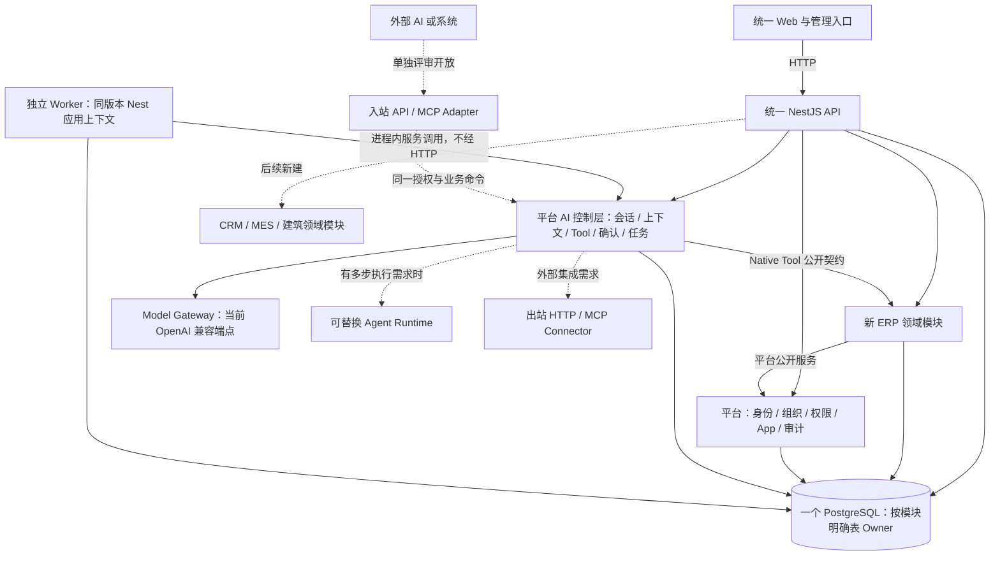

# ADR-002：AI 运行边界与外部协议

状态：2026-09-29 采纳为**目标架构与后续扩展准则**。本页区分已实现、本阶段继续完善和未来按需评审的能力；不把外部建议或架构图视为已交付事实。

## 决策

1. **Enterprise AI Gateway 是平台拥有的逻辑控制边界，首期留在 NestJS 模块化单体内。**它负责从服务端重建租户、成员和 App 上下文，执行应用启用/权限/对象范围检查，管理会话、Tool 调度、确认、任务、用量与审计。名称不意味着另起网关进程或让内部应用经 HTTP 调用。
2. **区分 AI 控制层、Agent Runtime 与 Model Gateway。**控制层保有业务授权和执行权；Runtime 只处理模型交互及必要的多步 Tool 循环；Model Gateway 处理模型端点、密钥、调用与用量。任何 SDK 都不能接管租户授权、业务确认、事务和成功回执。
3. **内部调用使用代码级公开契约。**Web → 统一 API 使用 HTTP；ERP/CRM/MES/建筑模块 ↔ 平台模块、AI Tool → 业务应用命令在同进程通过公开接口调用。禁止为了模块边界在本系统内绕行 HTTP/MCP，也禁止跨模块直接写 Repository/表。采购入库等原子流程继续使用同库事务。
4. **Tool 定义归平台/应用所有，执行归业务所有。**统一声明稳定 ID、所属 App、输入校验、动作权限、读写及确认级别、幂等和回执语义；平台调度时按目标 App 重建上下文，应用服务再次校验对象与状态。现有 `AppAiProvider` 是 ERP 的首个实现；有第二个应用时扩展为按 `appId` 查找的注册机制，避免平台代码依赖 ERP 内部类。Tool 清单不能仅凭模型提示词或某个 SDK 的函数定义作为授权依据。
5. **MCP 是外部适配协议，不是内部模块骨架。**平台使用外部 MCP/HTTP 工具，或向外部 AI 开放经选择的业务能力，都须先有真实集成场景、独立身份映射、租户/App/对象授权、审计、限流与回执设计。入站 MCP Server 和出站 Connector 分开评审；首期不建设空服务，也不把内置 ERP Tool 直接公开。
6. **运行时和模型供应商可替换，但只为真实需求增加适配器。**当前 OpenAI 兼容 `chat/completions` 调用继续满足已实现的 ERP 场景。出现多步 Tool 循环、恢复/暂停或模型能力差异等具体需求，并有权限、确认、用量、持久化和回归样本时，再评估 OpenAI Agents SDK 或其他 Runtime。DeepSeek 等模型须通过各自端点与真实样本验证后接入；不因兼容接口就宣称完整适配。

## 对架构图的校正

以下是**目标关系图**；实线代表当前代码已有的调用边界，虚线代表尚待真实场景和验收的扩展。当前代码仅有 ERP；CRM、MES 和建筑应用会在同一架构内重新开发，旧项目不是正在迁入的运行模块。

图中平台能力**并非每项都已完成客户验收**；准确进度以 [18 开发与内部验收记录](18-开发与内部验收记录.md) 为准。当前数据库是单 PostgreSQL、按模块拥有表；不预定一应用一 Schema。文件、知识、集成、通知、向量检索、Redis、RabbitMQ、Kubernetes、企业微信/飞书/钉钉和移动 App 均由真实场景与部署规模触发，不能因出现在参考图上就进入首期交付清单。

三份外部建议中，采纳“自有薄控制层”“内部代码级 Public Contract”“Native Tool 优先、MCP 用于外部”的原则；OpenClaw 的渠道/会话设计只作为未来多入口参考，OpenAI Agents SDK 作为 Runtime 候选，DeepSeek Harness 作为研究对象。参考图中的“旧三应用已有并迁入平台”、一应用一 Schema、完整 Knowledge/Integration/Notification 中台及可选基础设施的现成部署状态均不采纳；三套新应用按既定顺序重做，公共业务能力仍按第二个真实消费者与语义评审准入。

## 扩展触发与准入

| 候选 | 什么时候做 | 接入前必须证明 |
| --- | --- | --- |
| 通用 Tool Registry | CRM 或第二个真实 App 的 Tool 注册时 | `appId` 路由、清单校验、权限撤销、不同 App 同名 Tool 隔离与审计测试。 |
| Agent Runtime Adapter | 单次结构化模型调用不能可靠完成已确认的多步场景时 | 中断/恢复、确认后重鉴权、失败幂等、会话隔离、用量与真实模型评测；SDK 不绕开原业务命令。 |
| 第二种模型 Provider | 客户模型选择、区域/成本或模型能力提出明确需求时 | 真实模型的结构化输出、错误/超时、Tool 行为、数据处理与用量核对。 |
| 外部 Connector 或入站 MCP | 已确定外部系统、调用方、动作和数据范围时 | 身份映射、最小授权、租户隔离、凭据存储、限流、审计、失败恢复与撤权。 |
| 新渠道 | 客户确需网页之外的入口时 | 渠道账号与平台成员绑定、会话归属、对象权限和高影响动作确认方式。 |

参考资料仅用于评估候选技术，不构成依赖决定：[OpenAI Agents SDK 官方文档](https://openai.github.io/openai-agents-js/)、[OpenClaw 多租户托管说明](https://docs.openclaw.ai/gateway/multi-tenant-hosting)、[DeepSeek Harness 官方仓库](https://github.com/deepseek-ai/deepseek-harness)。OpenClaw 文档明确以一个 Gateway 对应一个信任边界，不能替代本平台的共享云租户授权；DeepSeek Harness 当前标记为开发者预览。因此两者只供研究，不能直接作为现有共享云控制层。供应商现状以后接入时重新核验。
