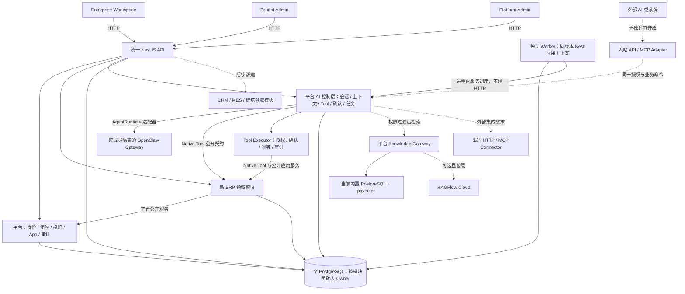

# ADR-002：AI 运行边界与外部协议

状态：2026-10-12 按 D-029 同步当前实现。平台控制层、应用 Provider、OpenClaw 与内置知识引擎边界已交付，真实模型/Tool/知识引用有一名生产成员的工程证据。RAGFlow Cloud、生产定时备份和真实客户场景继续按 D-022 暂缓；其他成员与容量须单独配置/验证。

## 决策

1. **Enterprise AI Gateway 是平台拥有的逻辑控制边界，首期留在 NestJS 模块化单体内。**它负责从服务端重建租户、成员和 App 上下文，执行应用启用/权限/对象范围检查，管理会话、Tool 调度、确认、任务、用量与审计。名称不意味着另起网关进程或让内部应用经 HTTP 调用。
2. **区分 AI 控制层与 OpenClaw 执行基础。**控制层保有业务授权和执行权；OpenClaw 承担首阶段 Agent/会话/模型调用，经受控适配接入。客户执行统一走 Runtime 适配器；原有直接 Model Gateway 只在显式 `NODE_ENV=test` 且 `AGENT_RUNTIME_PROVIDER=test-model` 的回归模式执行。无需强制无业务价值的第二轮模型调用。任何外部组件都不能接管租户授权、业务确认、事务和成功回执。
3. **内部调用使用代码级公开契约。**Web → 统一 API 使用 HTTP；ERP/CRM/MES/建筑模块 ↔ 平台模块、AI Tool → 业务应用命令在同进程通过公开接口调用。禁止为了模块边界在本系统内绕行 HTTP/MCP，也禁止跨模块直接写 Repository/表。采购入库等原子流程继续使用同库事务。
4. **Tool 定义归平台/应用所有，平台治理执行，业务应用提交结果。**统一声明稳定 ID、所属 App、输入校验、动作权限、读写及确认级别、幂等和回执语义；平台统一执行点按目标 App 重建上下文、校验策略与确认，ERP Native Tool 经公开 Application Service 执行，应用服务再次校验对象与状态。`AppAiProvider` 由各业务应用实现，平台 `AiProviderRegistry` 按当前已授权 AppContext 选择 Provider，校验 Tool/权限命名空间和 Agent 使用权。通用注册及第二应用隔离协作已验证，正式仅注册 ERP；新应用业务规则继续由自己的 Service 持有。Tool 清单不能仅凭模型提示词或 SDK 函数定义作为授权依据。
5. **MCP 是外部适配协议，不是内部模块骨架。**平台使用外部 MCP/HTTP 工具，或向外部 AI 开放经选择的业务能力，都须先有真实集成场景、独立身份映射、租户/App/对象授权、审计、限流与回执设计。入站 MCP Server 和出站 Connector 分开评审；首期不建设空服务，也不把内置 ERP Tool 直接公开。
6. **直接采用 OpenClaw，不做多候选选型 PoC。**现有 OpenAI 兼容 `chat/completions` 链用于迁移期回归；首阶段把 ERP Assistant/Skill/Tool 接入 OpenClaw 的 Agent/会话/模型能力。业务代码不得直接依赖其内部 SDK；适配层保留平台控制的上下文、动作 ID、Tool 拦截和结果转换。实际切换必须以同一组 ERP 样本证明功能、权限、用量、持久化与故障状态正确，之后关闭旧客户可用链；这是实施验收，不是重新选供应商。
7. **通过平台契约选择文档知识引擎，当前使用内置 PostgreSQL + pgvector。**平台拥有 KnowledgeSpace、文档/版本、Owner、权限、引用和索引映射；RAGFlow 执行解析、索引、检索，不作为本平台 Agent/会话/模型或业务事实的权威来源。D-018 曾选择 RAGFlow Cloud；D-020/D-022 已将内置引擎确定为当前方案，Cloud 保留适配器并暂缓，不本地部署。通过受控适配器接入，并按 [24](24-首阶段新增能力与验收.md) 验证检索前权限、引用、撤权、删除重建及故障恢复。OpenClaw 与 RAGFlow 均不得获得比当前用户和场景更多的企业数据。
8. **以可替换契约接入指定组件。**平台持有稳定会话/消息/动作/任务、Tool 定义、审计、原始文档/版本、权限和引用 ID；供应商 ID 只存在适配映射。Runtime 契约覆盖会话执行、流式事件、Tool 请求、取消/超时和状态查询；知识引擎契约覆盖摄取/删除/重建、检索、引用定位和处理状态。当前已交付 OpenClaw Runtime、内置知识和 RAGFlow 适配契约，隔离故障/替换测试与生产已验证场景见 [41](41-六批优化交付与线上验收.md)，不把契约存在视为所有供应商能力已接通；未来替换时新增适配器、通过同一契约测试、迁移或重建数据，再按发布配置切换和回退。运行中的任务、私有记忆、索引向量等组件内部状态不承诺自动迁移，也不承诺无中断热切换。

首阶段目标链路见 [22](22-AI体验与首阶段Agent策略.md#首阶段必须建立的边界)：先由服务端认证和授权 App，再解析可用 Agent；Enterprise AI 与 ERP 内会话共用 `erp.assistant` 和执行服务。Runtime 只产出回答或 Tool 请求，不能根据 Agent 配置直接获得权限；Tool 执行点负责重鉴权、确认、幂等、审计和业务回执。业务提交成功但 AI 动作记录更新失败时，先按单据和幂等键核实结果，不能无条件重试。

## 对架构图的校正

以下是**D-016/D-017 关系图**；已实现调用边界，真实外部验收以 [18](18-开发与内部验收记录.md) 为准。当前代码仅有 ERP；后续业务系统由用户另行确定并在同一架构内开发，CRM 暂不引入，旧项目不是正在迁入的运行模块。

图中目标能力**并非已完成客户验收**；准确进度以 [18 开发与内部验收记录](18-开发与内部验收记录.md) 为准。当前数据库是单 PostgreSQL、按模块拥有表；不预定一应用一 Schema。文件/企业知识、OpenClaw、知识产品与三端已由 D-016 纳入首期；Cloud 由 D-022 暂缓；通用集成、通知、额外缓存/数据库和移动 App 仍按真实场景或部署规模触发。

保留“自有控制层”“内部代码级 Public Contract”“Native Tool 优先、MCP 用于外部”的原则；D-016 直接指定 OpenClaw 和 RAGFlow，并增加完整知识产品。D-029 不固定下一套业务系统；旧应用保留独立部署，公共业务能力仍按第二个真实消费者与语义评审准入。

## 扩展触发与准入

| 候选 | 什么时候做 | 接入前必须证明 |
| --- | --- | --- |
| 跨 App Tool Registry | D-029 已交付可信代码注册并通过隔离第二应用验证；正式只注册 ERP，用户在线发布动态代码/工具未提供 | `appId` 路由、清单校验、权限撤销、不同 App 同名 Tool 隔离与审计测试。 |
| OpenClaw 与知识引擎实际接入 | 当前 OpenClaw + 内置 pgvector；D-022 暂缓 RAGFlow Cloud | 按 [24](24-首阶段新增能力与验收.md) 验证隔离、撤权、Tool 拦截、业务回执、知识权限、引用和故障恢复；不再比较候选。 |
| 第二种模型 Provider | 客户模型选择、区域/成本或模型能力提出明确需求时 | 真实模型的结构化输出、错误/超时、Tool 行为、数据处理与用量核对。 |
| 外部 Connector 或入站 MCP | 已确定外部系统、调用方、动作和数据范围时 | 身份映射、最小授权、租户隔离、凭据存储、限流、审计、失败恢复与撤权。 |
| 新渠道 | 客户确需网页之外的入口时 | 渠道账号与平台成员绑定、会话归属、对象权限和高影响动作确认方式。 |

实施参考：[OpenClaw 多租户托管与信任边界](https://docs.openclaw.ai/gateway/multi-tenant-hosting)、[RAGFlow 官方部署说明](https://github.com/infiniflow/ragflow/blob/main/docs/quickstart.mdx)。OpenClaw 一个 Gateway 只对应一个信任边界，不能替代平台共享云租户授权；实际生产版本和配置在接入时固定并验证。其他候选不进入 D-016 的首阶段选型流程。

## D-047：受控的memory-core旁路检索

2026-10-20增加独立私有memory-core索引服务；不向现有Gateway默认工作区注入跨租户信息。平台持有记忆原文/范围/版本和删除清理任务，授权过滤后仅将确认的当前记录投影给固定版本官方CLI；命中返回后再核对SQL版本。会话继续逐轮Incognito，摘要也经现有Runtime只读执行；业务授权与确认仍由平台/应用拥有。当前关键词及中文token投影，不升级或声称已接入LanceDB/语义检索。详见[50](50-AI分层记忆与上下文.md)。
