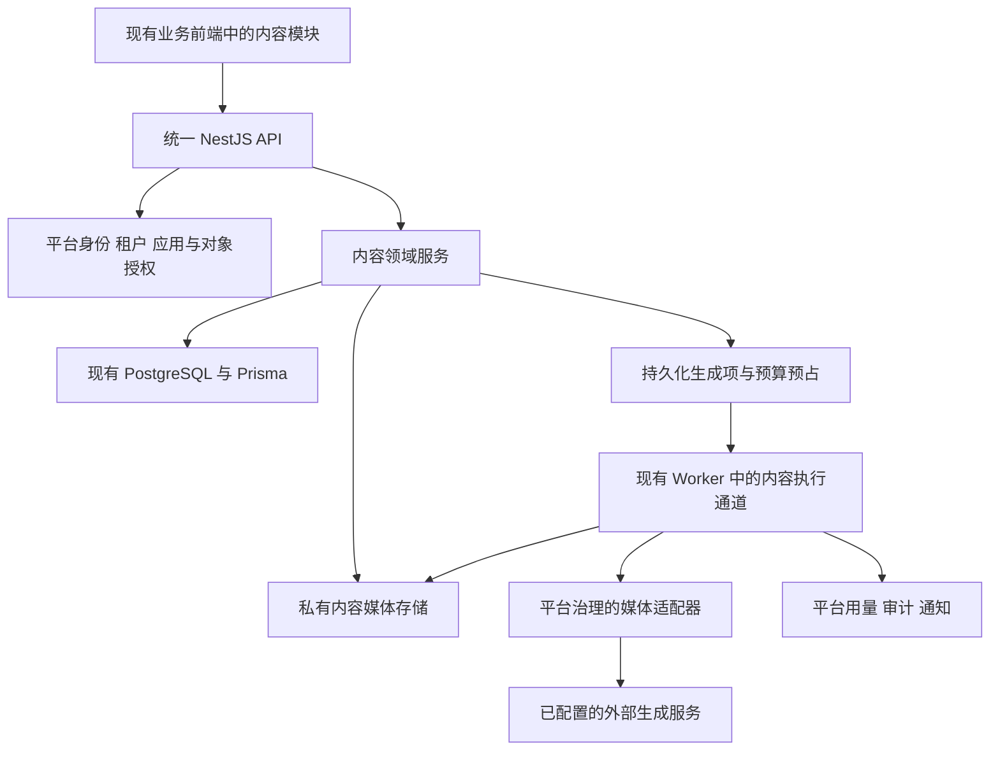

# 企业品牌内容工作台平台接入与数据契约

2026-11-03 本地实现新增视频批次、多参考与图片规格、画布可选配置。兼容原项目及生成任务，无数据库结构迁移。接口和验收见[18](18-图片与视频工作流开发验收.md)。

2026-11-02 D-135实施更新：用户新增企业文字、生图、视频三用途配置，未自定义时沿平台默认，默认文字沿已批准DeepSeek Flash；实际契约与边界见[15](15-品牌内容创作官与企业模型配置.md)。下文保留原方案历史，配置现状以该更新及正式验收为准。

2026-10-31 接入补充已实现：项目 brief 新增 workflow=studio，允许不关联品牌/产品；旧版式保留原必填。generation.mode=image 接收 instruction、size 和可选 referenceAssetId，沿原预览/幂等批次/Worker 保存一个完整图，Studio 数据不要求叠加图层。首页上传 draft=true 按成员私有，提交事务再次授权并绑定到创作；不建立另一套身份、任务或素材存储，无 SQL 迁移。详见 [12](12-即梦式创作工作台重构与验收.md)。

最新阶段A实施与验收见[08](08-图文日常创作开发与验收.md)，含直接编辑、工作草稿、文案采用、同源排版和后台交付。本文中其余设计目标仍按路线图区分，未全部实现。

2026-10-30实施更新：图文首版已按后续用户授权开发，实际接口、数量限制、金额对账边界及分层验收见[127](../127-企业品牌内容工作台开发与验收.md)。下文设计目标不代替实施证据。

上级方案：[125](../125-企业品牌内容工作台方案.md)。本页依据当前工作区源码核对接入位置；拟新增名称、接口和数据模型均为设计，不表示已经实现或接通。

## 架构边界

沿用[ADR-001](../ADR-001-技术栈决策.md)、[ADR-002](../ADR-002-AI运行边界与外部协议.md)和[应用接入契约](../10-应用接入契约.md)：同一个 pnpm Monorepo，业务 React/Vite 前端、NestJS 模块化 API、Prisma/PostgreSQL、独立 Worker。内容业务作为应用模块，不新建独立前后端服务、Supabase、Fastify、PGMQ 或第二套身份系统。

平台拥有身份、可信上下文、应用开通、技术治理和用量账本；内容模块拥有品牌、营销产品资料、项目、作品、批次、审核和交付事实。AI只通过已授权的应用服务操作这些对象。内部模块间采用公开代码契约，不绕行 MCP 或回环 HTTP。

## 当前基础与接入缺口

| 已核对入口 | 可沿用基础 | 本模块仍需完成 |
| --- | --- | --- |
| [应用清单](../../apps/api/src/modules/platform/app-registry.ts)、[应用注册](../../apps/api/src/modules/platform/application-registry.ts)、[组合根](../../apps/api/src/modules/app.module.ts) | Manifest、权限命名空间、应用启用和可信注册 | 注册 `content`，新增权限贡献及服务装配；不能只修改清单数组 |
| [AuthService](../../apps/api/src/modules/platform/auth.service.ts)、[RequestContext](../../apps/api/src/modules/platform/context.ts) | 会话、Tenant、Membership、TenantApp、后台恢复重新授权 | 内容对象和素材范围检查，应用岗位；不直接信任前端tenantId/角色 |
| [默认开通策略](../../apps/api/src/modules/platform/default-apps.ts)、[QuotaService](../../apps/api/src/modules/orchestration/quota.service.ts) | 显式开通、套餐应用范围、额度预占与账本 | `content` 需交付后明确开通；现有默认三应用清单不自动扩展 |
| [前端注册器](../../apps/web/src/applications.tsx)、[App](../../apps/web/src/App.tsx)、[应用导航](../../apps/web/src/application-navigation.ts) | 同前端路由、应用目录、企业内恢复和切换 | 导航、元数据、深链接与助手的第四应用适配；现有非CRM/MES分支会回落ERP |
| [AiConversation](../../packages/frontend/src/AiConversation.tsx)、[前端API](../../packages/frontend/src/api.ts) | 会话交互、公共反馈、同源API和会话身份 | 当前scope和资源类型有固定应用集合；创作上下文、对象引用及嵌入助手需适配 |
| [AppAiProvider](../../apps/api/src/modules/ai/app-ai-provider.ts)、[Provider注册器](../../apps/api/src/modules/ai/provider-registry.ts) | 应用事实、Tool、预览、确认与真实回执 | Content Provider/Tool；现有应用Provider不等于媒体模型供应商接口 |
| [Worker](../../apps/api/src/worker.ts)、[TaskService](../../apps/api/src/modules/orchestration/task.service.ts)、[CommandRegistry](../../apps/api/src/modules/orchestration/command-registry.ts) | Worker执行通道、业务命令、版本、租约和幂等经验 | 媒体请求/查询/恢复/入库专用执行通道；不把外部生成塞进业务数据库事务 |
| [Prisma schema](../../apps/api/prisma/schema.prisma)中的AiTask、AiModelUsage、UsageRecord | 对话任务、Token审计、Decimal用量与费用记录 | 按张等媒体计量、价格快照、未知费用和预算结算；不能套用聊天Token与三次试用 |
| [知识存储](../../apps/api/src/modules/knowledge/knowledge-storage.ts) | 私有目录、存储键、内容哈希等已有实现经验 | 内容媒体存储及授权接口；知识上传目前是8 MiB与固定文档类型，不是媒体资产服务 |
| [原生AI开关](../../apps/api/src/modules/ai/native-ai-policy.ts)、[BOM视觉服务](../../apps/api/src/modules/mes/bom-vision.service.ts) | 现有服务开放边界、避免未知用量重试的工程处理 | 图像输出能力需独立验收与明确配置，不借本模块开放现有应用的模型开关 |

核对源码不等于核对当前生产配置。本轮不改变任何开关或开通状态。

## 注册与目录设计

拟用 `appId=content`、`routePrefix=/content`、`defaultAgentId=content.assistant`。应用权限均以 `content.` 开头。前端仍在 `apps/web` 内，通过可信构建注册；不增加第四套前端工程。

| 拟代码归属 | 职责 |
| --- | --- |
| `apps/web/src/content/` | 应用页面、创作布局、编辑器、素材/结果板和内容服务调用 |
| `apps/api/src/modules/content/` | 领域服务、Controller、公开命令/Reader、应用权限、Content AI Provider和媒体执行 |
| 现有 `platform` 与 `orchestration` 模块 | 明确需要的身份/任务/用量契约扩展；不搬入内容业务表 |
| 现有 `ai` 模块 | 受控对话与媒体适配边界、凭据引用和用量治理 |
| 现有 Prisma 迁移与 Worker | 内容模型、索引、执行与清理通道 |

前端接入需同时处理应用识别、导航清单、元数据读取、默认落地页、状态Provider和AI入口。先为content完成最小的可信适配，再决定注册元数据是否需要补充导航或助手展示方式；不预建动态页面或插件引擎。进入内容编辑页使用嵌入助手，公共浮窗不再重复出现，退出后恢复原应用行为。

首版沿公共主题与组件。专用布局和编辑器样式作用域限定在内容根节点，不能修改全局CSS使ERP/CRM/MES或管理端变色、隐藏导航或改变弹窗行为。

## 业务数据设计

以下是拟模型职责，实现时可合理合并表结构，但必须保留租户边界、不可变版本与幂等约束。

| 拟对象 | 关键内容与约束 |
| --- | --- |
| ContentBrand及规范版本 | tenantId、稳定品牌ID、version、状态、规范JSON和素材引用；发布后版本不可覆写 |
| ContentProduct及资料版本 | tenantId、稳定资料ID、version、人工确认字段、原图、来源引用与有效期 |
| ContentAccessGrant | tenantId、membershipId、应用岗位；项目参与人另按项目关联，不修改全局Membership.role语义 |
| ContentProject | tenantId、负责人、共享范围/参与人、当前需求、revision、所选品牌/产品版本；更新校验expectedRevision |
| ContentTemplateVersion | tenantId、模板ID、version、尺寸、图层约束、锁定项和允许字段；内置模板与企业模板明确来源 |
| ContentArtifactVersion | tenantId、projectId、作品ID、revision、图层/文案、素材、来源快照、检查结果；送审/批准对象固定到此版本 |
| ContentAsset | tenantId、归属品牌/项目、storageKey、hash、MIME、尺寸、字节数、来源、许可说明、删除状态与引用关系 |
| ContentGenerationBatch | tenantId、projectId、requestKey、fingerprint、需求快照、预算、统计和范围；批次状态由明细推导 |
| ContentGenerationItem | tenantId、batchId、itemKey、输入快照、状态、leaseToken/到期、版本、结果与当前尝试；同批itemKey唯一 |
| ContentProviderAttempt | tenantId、itemId、attemptKey、供应商/模型/能力、外部ID、提交/完成状态、请求指纹、价格快照和用量回执 |
| ContentReview | tenantId、项目、确切作品版本清单、审核者、批注、决定、策略版本；一次决定可追溯且不能作用于未来修订 |
| ContentExport | tenantId、选定版本清单、审核依据、幂等键、打包状态、私有文件、过期时间 |

复合唯一键与关系同时校验tenantId。项目中引用的品牌、产品、资产、模板和参与者必须属于同一企业且当前可用；UUID不可猜测不能代替授权。业务JSON使用明确schema与版本，不允许任意脚本或HTML执行。

## 权限与AI操作

拟权限包括 `content.project.read/create/edit/share`、`content.brand.read/manage/publish`、`content.product.read/manage`、`content.template.manage`、`content.generate`、`content.review`、`content.export`、`content.settings.manage`、`content.usage.read`、`content.ai.use`。贡献函数根据应用岗位给出操作权限，Service再校验对象范围、版本、审核策略与锁定元素。

对话使用现有受控Runtime。内容Provider提供当前项目有权的资料与快照，Tool调用与页面调用使用相同Service。读取不另要求生成授权；外部付费生成在清单核对时一次确认具体范围，授权仅覆盖该版本、数量、素材范围与预算。批量审核、导出和删除各按其业务后果记录确认，不把模型输出当成执行回执。

Tool例子为 `content.project.prepare`、`content.artifact.propose_edit`、`content.batch.preview/submit`、`content.review.submit`。名称为拟定接口；每项需注册输入schema、权限、确认等级、版本和结果。直接点击“生成”与对话发起生成形成同样的批次，不存在绕过预算的对话捷径。

## 持久任务与供应商执行

ContentGenerationItem是媒体生成业务状态的唯一权威记录。复用现有PostgreSQL与Worker机制，为内容新增独立执行通道；AiTask继续承担已支持的对话/整理任务，BusinessTask可在确有跨应用编排时引用内容公开命令，不复制一套相互竞争的媒体终态。

| 状态 | 含义与恢复 |
| --- | --- |
| queued | 已持久化且预占预算，尚未向供应商提交 |
| submitting | 已建立调用尝试，正在提交；中断后先核对该尝试，不能默认重新发送 |
| submitted | 已保存外部任务ID，后续只查询此请求 |
| processing | 供应商确认执行中；查询失败按查询退避处理 |
| storing | 已取得生成结果，下载/校验/入库；失败后恢复入库，不重新生成 |
| succeeded | 文件、结果记录与用量处置已持久化；回执可回查 |
| failed | 明确失败且可说明费用状态；是否可重试由阶段和供应商回执决定 |
| needs_reconciliation | 提交或结果未知；保留原请求与预算，禁止自动另发付费请求 |
| cancel_requested | 用户请求停止，尚不能确认供应商终止 |
| cancelled | 本地尚未提交已取消，或供应商明确确认终止；费用按实际回执结算 |

内容执行状态与费用状态分开保存。已有可靠结果但用量未知时保留成功作品，标记“费用待核实”，对应预算继续预占；不能把成功作品误报为生成失败并诱发重试。提交或结果本身未知才使用执行状态needs_reconciliation。

提交事务只做鉴权、冻结输入、幂等检查、预算预占和排队记录。数据库事务外调用供应商；提交前持久化attemptKey，支持供应商幂等键时复用同一键。外部网络无法与本地事务原子提交，发生“供应商已接受、本地未保存ID”时必须进入待核实，不能声称恰好执行一次。

Worker采用原子认领、租约续期与fencing token。恢复、提交、入库和终态分别重新鉴权并校验当前租约；旧Worker或迟到回调不能覆盖新状态。远端查询与入库的重试不增加生成次数；明确重做才产生新尝试并再次检查预算。

批次可部分完成或待核实。取消停止未提交项，已提交项查询或发出供应商取消；迟到的生成结果可按策略保留在受限记录供核对，不能把已取消/撤权任务自动变为可见成功或释放已发生费用。通知发起人和有权负责人，通知链接再次检查访问范围。

## 媒体适配与成本

现有AppAiProvider是业务AI契约，不是图片API。拟在平台AI边界内增加受控媒体适配器，由内容执行器请求图像输出。首批只验收少量满足任务的供应商与模型，不以模型数量作为交付目标。

2026-10-30用户指定首批渠道为火山方舟：图片 `Doubao-Seedream-4.5`，视频 `Doubao-Seedance-1.0-pro-fast`，复用已有方舟凭据。接入时核实实际API型号/接入点、账户权限及能力，不擅自替换型号。现有 `infrastructure/bom-vision.env.example` 展示了方舟服务端配置入口，但内容模块不得依赖MES内部Provider；凭据应从受控平台配置引用，必要时扩展媒体用途的绑定。此处未验证实际Key或模型可用性，也未复制凭据。视频按后续阶段实施。

适配器至少提供能力查询、估价、提交、查询结果、取消支持说明和用量/费用回执。能力元数据明确参考图数量、编辑/蒙版支持、比例、分辨率、输出格式与异步方式；不能只按模型名称推断。参考图编辑不等于原生蒙版编辑，多尺寸重排不等于重新生成。

凭据留在平台配置与加密边界内，内容模型绑定引用受控凭据和能力；若现有配置接口不覆盖媒体用途，需要先扩展契约。现有企业聊天三个字段不自动获得图片输出能力，默认聊天试用和自定义渠道策略不自动授予无限媒体预算。当前应用AI开关不因本方案改变。

媒体成本单位首版包含图片张数、输出规格与实际供应商计价；后续视频再增加时长、分辨率等。扩展现有UsageRecord/QuotaService承载媒体指标与预算，保留Decimal、币种、价格版本、估价、实际用量和未知状态。AiModelUsage继续记录真实文本调用，不能用虚构Token表示图片费用，也不将一次编排与其图片调用重复计费。

同一操作的UI、Tool和Worker结算使用关联的唯一键，预占与最终结算单调转换。超时不等于免费，未知费用不能计作0或自动退款。无可靠上限且企业未明确允许的模型不进入自动批量模式；成本未知项暂停对应范围的新自动调用，查询原记录或由有权人员处理。

## 素材存储与生命周期

首版沿现有部署方式使用私有持久卷保存内容媒体，通过内容模块授权接口读写；后续容量需要时再实现对象存储适配。知识库和BOM存储保留各自Owner与解析流程，不直接作为内容素材库。

上传初始建议PNG/JPEG/WebP、单张20 MiB和4000万像素上限，字体文件另按模板/授权策略验证；服务端校验实际解码结果、尺寸与资源开销。首版不接受可执行插件、任意脚本或未经处理的SVG。供应商结果只从已批准的地址和协议获取，外部参考优先通过受控上传或短期授权链接传递，不让浏览器获得供应商密钥。

原件与已引用作品素材随项目保留；删除进入建议7天回收期，仍被有效作品引用的资源不能提前清理。失败临时文件建议24小时清理，导出包建议24小时失效后可重建；最终期限在存储评估时校准。到期不删除作品版本或核对所需的调用记录，成本账本与业务素材删除分别处理。

下载、缩略图、导出与AI引用均检查当前权限；去重限同租户。已导出的离线文件无法靠平台撤权收回，界面不作此承诺。备份与恢复须同时覆盖数据库和内容文件及一致性清单，恢复验证不能只检查数据库有记录。

## 拟接口与命令

HTTP基址沿现有版本：`/api/v1/tenants/:tenantKey/apps/content`。下列为设计清单，最终字段schema随领域实现验证；不在本轮生成Controller或迁移。

| 接口组 | 主要操作 | 关键约束 |
| --- | --- | --- |
| `/metadata` | GET应用权限、已交付能力、可用规格 | 来自可信上下文；UI只展示真实能力 |
| `/brands`、`/products`、`/templates` | GET/POST、PATCH草稿、发布新版本 | expectedRevision、来源与许可；发布旧版本不可覆写 |
| `/projects`、`/projects/:id` | 列表、建立、更新需求与参与人 | tenant与对象ACL；并发更新冲突返回409 |
| `/projects/:id/artifacts` | 读取/保存/比较作品修订 | 保存、采用、送审关联确切修订 |
| `/batches/preview`、`/batches` | 预览清单与估价、提交批次 | previewHash、requestKey、输入/权限版本、预算与短有效期 |
| `/batches/:id`及子项动作 | 查询、取消、明确失败重试、待核实处理 | 不使用客户端状态或重新POST代替查询 |
| `/assets`及内容读取 | 上传、索引、读取、回收 | 文件真实类型、引用、大小和ACL；二进制上传适配现有JSON客户端 |
| `GET /assets/archive` | 批量下载原始文件 ZIP | 1–20 个不同资产 ID，合计最多 80 MiB。逐项鉴权，临时 ZIP 随响应清理 |
| `POST /projects/:projectId/assets/:assetId/transform` | 裁剪、顺时针旋转 90°、水平镜像 | 仅当前项目或企业共享图片。要求目标项目写权限，结果另存为作品和私有资产 |
| `/reviews` | 送审、批注、通过、退回、撤回 | 固定版本、审核者权限与企业审核策略 |
| `/exports` | 预览清单、提交打包、下载 | 已批准/免审版本、幂等和文件有效期 |
| `/ai`、`/settings`、`/usage` | 应用对话、管理和用量 | 复用平台治理；新scope与媒体能力先适配再启用 |

生产预览仅在短期有效，建议5分钟；提交时重算输入指纹、对象版本、模型能力、价格和授权。变化时返回差异并刷新清单，不能沿用过期估价偷偷执行。重复requestKey且参数相同返回原对象，不同参数返回409。SSE如后续启用，只传有权状态；断线后GET权威对象即可恢复，不依赖浏览器保持连接。

## 跨应用与开放边界

首版无需ERP或CRM即能完成核心闭环。后续引入来源时，只有已实现并验收的Reader才显示入口，并校验来源应用启用、成员与对象权限。内容保存只读来源快照与显式关联，不回写产品价格、库存、客户或交易。

导出文件交给人员使用不等于自动发布。社交平台、广告账户与外部MCP连接在有明确场景、授权和真实回执前不进入本模块菜单。

## ContentCanvas可选项目视图

2026-11-02新增轻量画布契约见[16](16-轻量创作画布.md)。采用现有项目身份/范围和内容素材、生成任务；新增一表，不新增模型系统或独立账号。生成请求的canvas为可选绑定，旧请求指纹保持兼容；Worker与画布保存串行处理，原图和历史作品保留。

资产索引可按 `projectId` 或企业共享范围读取，支持 `q` 名称搜索、`media=image|video` 及 `sort=newest|oldest|name`。图片工具使用现有 Pillow 进程和私有存储，无数据库迁移。画布另存后的导入使用稳定节点 ID，重试时复用已写入的节点。
