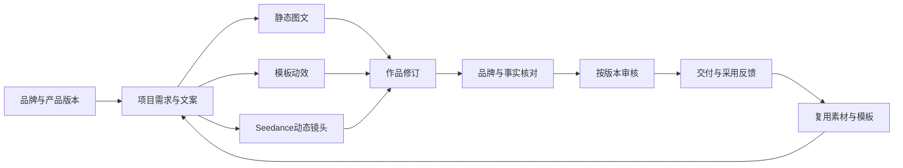

# 企业品牌内容工作台后续完善路线图

2026-10-30 最新范围以[首版收敛与Loomic核查](09-Loomic本地验证与首版收敛.md)为准。下文保留历史设计；品牌发布/产品建档/图层编辑不再作为首版创作前置，不按旧B—D清单自动扩建。简化尚未实施。

日期：2026-10-30。定位继续沿用“企业品牌内容生成工作台”，主场景为产品营销素材包。现有图文首版已在平台内完成本地实现和工程验收，实际范围见[品牌内容开发与验收](../127-企业品牌内容工作台开发与验收.md)；尚未上线或取得真实客户品牌样本验收。

后续先补齐日常创作效率、品牌约束、批量生产与企业治理，再把短视频纳入同一套项目、素材、版本、审核和交付体系。账号、租户、UI基础、API、数据库和Worker继续沿现有平台。独立主题继续后置，创作区可以采用更适合编辑的布局。

规划完成后，用户已授权实施阶段A；当前完成范围见[阶段A开发与验收](08-图文日常创作开发与验收.md)。本页保留路线图与原始缺口基线，其余阶段仍待实施。下一批可执行范围见[第一批完善任务](07-下一阶段实施清单.md)。

## 怎样才算完整

企业日常使用应覆盖七个连续环节，而不仅是单次生成成功。

| 环节 | 完整后的行为 | 对企业的价值 |
| --- | --- | --- |
| 准备资料 | 建立品牌规范，按产品编码维护图片、参数和活动事实，可导入、检索与复用 | 减少重复录入和资料用错 |
| 发起创作 | 选择品牌和产品，用一句需求开始；高级选项按需展开 | 首次使用能独立完成一包素材 |
| 生成与编辑 | 先选文案和版式，再生成必要视觉；直接修改价格、标题、图片和尺寸 | 降低修改成本，保留关键事实 |
| 批量生产 | 多产品、多文案变体、多尺寸形成可核对清单；成功项留存 | 稳定产出一批可交付素材 |
| 审核协作 | 指定审核人、标注意见、精确到版本批准或退回；问题版本可撤回交付 | 品牌与协作责任清楚 |
| 交付复用 | 下载、打包或受控分享已审核版本；优秀作品沉淀为模板 | 让内容在团队内持续复用 |
| 管理反馈 | 能核对任务、费用、资料来源、使用情况与有效产出 | 看清实际收益和异常消耗 |

图文和短视频都使用这条流程。ERP/CRM来源读取、自动发布及复杂专业设计能力是增强项，内容应用本身应能独立使用。

## 现有能力和需要补齐的部分

下表是阶段A实施前的缺口盘点，A阶段已补齐的能力以[08](08-图文日常创作开发与验收.md)为准。规划时判断依据[服务端](../../apps/api/src/modules/content/content.service.ts)、[前端](../../apps/web/src/content/ContentPage.tsx)、[数据与输入规则](../../apps/api/src/modules/content/content.rules.ts)及[媒体合成](../../apps/api/src/modules/content/content-media.py)。

| 能力 | 现有基础 | 后续缺口 |
| --- | --- | --- |
| 品牌中心 | 规范发布、版本、Logo、单个品牌色、语气与禁用词 | 品牌色板、可分发字体、Logo变体/安全区、模板约束、规范更新差异 |
| 产品资料 | 人工输入、原图、卖点/参数、价格和日期文本 | 独立产品编码、结构化规格、批量导入、活动事实、导入校对与去重 |
| 文案 | 事实组装、手工修改、通用助手建议 | 结构化候选、局部改写、一键采用、关键事实保护与旧建议失效 |
| 编辑器 | 图层选择、属性输入、锁定、手工保存新版本 | 拖拽缩放、对齐、图片裁剪、撤销重做、自动草稿、导出一致性与溢出提示 |
| 模板 | 三种内置版式、从作品保存位置/样式规则、版本引用 | 模板管理/发布、字段绑定、品牌变量、尺寸重排、跨产品/品牌复用规则 |
| 图像处理 | 背景生成、参考图编辑、矩形区域合成、商品原图叠加 | 抠图与边缘修整、画笔蒙版、选区羽化、场景扩展；效果需按样本验证 |
| 批量 | 多产品/变体生成，同背景复用于多尺寸，失败单项处理 | 批量选品/导入、一批中选样继续、批量改价改文案、筛选与容量治理 |
| 素材 | 企业共享/项目私有、图片上传和分页、历史引用 | 缩略图、名称/标签/产品检索、引用关系、重复素材、回收与存储策略 |
| 团队 | 应用岗位、项目参与人、版本送审、审核队列、站内通知 | 指定审核人、批注定位、按版本批量审核、交付撤回、受控外部预览 |
| 成本 | 请求数限制、原始用量、未知停止、人工费用登记 | 平台/企业/项目预算、价格版本和估算预占、账单导入与差异核对 |
| 大任务 | Worker租约/恢复、私有媒体、已有导出状态 | 异步导出、完整集合分页、缩略图/视频处理队列、任务公平性和资源观测 |
| 视频 | 已选定Seedance型号，未实现视频业务 | 视频适配、异步任务、时间线、图文转视频、字幕/音频、视频审核交付 |

现有完成记录中的合成样本验证继续保留。后续每一阶段都要形成自己的业务效果和运行证据，不能用首版测试数量代替新增能力的验收。

## 分阶段建设

| 阶段 | 优先目标 | 主要交付 | 退出条件 |
| --- | --- | --- | --- |
| A 图文可持续使用 | 减少编辑摩擦，补齐试点准备 | 直接编辑、撤销重做、可恢复草稿、字体/溢出检查、文案候选采用、基础任务与交付补强 | 一名创作者和另一名审核者，可完成三规格素材包；改价不生图，刷新不丢已同步草稿，未审版本不能正式交付 |
| B 图文批量生产 | 从单件创作变成日常生产工具 | 产品资料导入、素材检索/缩略图、模板绑定、多尺寸重排、批量替换、先选样再展开 | 多产品批次可定位资料和版本；部分失败只处理失败项，换文案/改尺寸不默认重生视觉 |
| C 企业协作治理 | 让团队和管理者能长期使用 | 指定审核、批注/批量审核、交付撤回、受控分享、费用估算/预占/账单核对、存储管理 | 多人协作和撤权有明确结果；预算与实际/未知费用可核对；过期或撤回的分享不可继续取文件 |
| D 品牌短视频 | 把已验证素材扩展为短视频 | 模板动效、Seedance动态镜头、时间线/字幕、上传音频、异步任务和视频交付 | 一个已审核产品项目可以交付视频；只改价格/字幕重新合成即可，不重新调用Seedance |
| E 业务连接与效果复用 | 降低录入成本并观察产出价值 | 按需ERP/CRM Reader、交付采用反馈、效果导入、模板推荐、经营视图 | 跨应用来源有授权和版本；能够计算采用产出的成本与返工情况 |

阶段按上述依赖推进。视频的能力核对和数据契约设计可以提前进行，付费视频联调放到具体功能开发时。若首批客户强依赖视频，可提前阶段D的最小闭环，同时保留阶段A的恢复、审核与费用控制。

阶段A至D构成目标完整版；阶段E的跨应用连接和平台发布能力按实际客户需求选做。阶段不是发布日期或工期承诺，开发时按工作包复杂度、依赖与验收结果拆分。

## 图文创作怎样完善

### 入口和工作区

创作首页保留“描述需求、选择品牌/产品、继续最近项目”。首次缺资料时在当前流程补齐基础品牌/产品，不要求用户跳转多个后台页面后重新输入需求。受众、渠道与变体等选项按需展开；沿用上次选择必须限定企业、成员和当前访问权限。

工作区按“作品/尺寸列表—画面—属性与内容”组织，窄屏切换为预览、图层、文案分区。常用操作是直接改字、拖动、缩放、裁剪、替换和对齐；高级图像生成选项进入相应工具。询问AI继续共用平台对话外壳，按当前项目/作品版本传递上下文，避免出现两套聊天记录和确认机制。

### 可恢复草稿和正式版本

增加工作草稿：自动同步编辑状态，显示保存/未同步/冲突结果。撤销重做作用于当前编辑过程，正式“保存版本/提交审核”生成可追溯修订；不把每次键盘输入都变成正式作品版本。

刷新、关闭和断网重连后恢复本人的工作草稿。其他人已经保存新版本时保留本地修改，提供差异和明确的重新采用方式。撤权后的本地缓存不能继续提交或成为共享内容。

### 品牌规则和模板

品牌规范补齐色板、字体、Logo变体和安全区。模板中的颜色/字体/字段应能绑定品牌与产品事实；复用模板时不把上一个品牌的色码、Logo或产品价格带到新项目。

把“产品事实、当前活动事实、画面文案”分开：例如活动价279元只作用于当前营销需求，不默认改写产品资料或未来ERP价格。用户可以明确把修改同步到所选尺寸的新修订；已批准或已交付版本保持原记录，不能被后台批量静默覆盖。

### 文案建议和品牌检查

提供标题、正文、卖点与行动语的结构化候选。采用前显示目标字段和差异，采用时校验项目、资料、作品版本；仅修改标题不顺带改价格、型号或声明。采用已有建议不再请求一次模型。

确定性检查覆盖字体/色板、Logo规则、必需声明、价格/日期、文字溢出及来源版本。自然程度、商品外观和品牌调性保留人工审核，不汇总成未经定义的“100%品牌一致”。

### 生成和局部修改

商品原图、Logo和关键文字继续采用独立受控图层。补充白底商品抠图、边缘修整与背景扩展，先验证样本和实现成本，再决定本地处理或专用服务；新增付费服务另行选型，不默认扩大当前模型范围。

矩形区域编辑逐步补画笔、擦除/反选、边界预览和区内羽化。保护区以实际输出像素或图层核对，不能用模型文字承诺代替验证。涉及商品姿态、包装或结构变化时，作为需单独核对的创意模式处理。

预览和导出应使用一致的字体、测量与版式规则。先提供少量可分发字体，检查长标题、长价格、中英文混排、换行与透明素材；超出可读范围时明确提示调整，不静默截掉关键内容。

## 批量生产和企业协作

产品资料先支持CSV/XLSX导入与校对：按编码匹配、明确新增/更新、逐行报错，导入后形成资料版本。营销资料不直接成为ERP商品主数据。素材库提供缩略图、标签、产品/品牌/项目过滤、来源与授权期限等必要资料，显示哪些作品仍在引用。

批次预览同时列出“产品数、文案/创意变体、交付尺寸、预计模型请求数”。例如10个产品各出3种尺寸，先以每产品一个背景设计30个交付项，预计10次背景生成；是否需要补画或新增创意由用户明确选择。先试制选定样本，再由用户继续其余项，不能因样本通过自动扩大调用范围。

审核先支持指定审核者和定位批注，再补按明确版本批量通过/退回。修改、重新送审和审核撤回分别保留记录。发现已批准内容有问题时，支持撤回交付、停用相关预览/下载链接并通知引用方；已经下载到外部的文件不能保证远程删除。

分享采用指定版本、访问范围、有效期和下载权限。外部预览与内部项目权限分开，有权人员明确开启后才产生链接；分享不会让项目中的原图、草稿和其他版本自动公开。先完成预览/审核交付，不把社交发布混成一个无法核对的“发布成功”。

## 费用和运行治理

图片继续优先Seedream 4.5，视频优先用户指定Seedance 1.0 Pro Fast，复用受控方舟凭据。平台媒体配置应管理凭据引用、用途、模型与能力版本；内容应用拥有创作语义与任务，不依赖MES业务Provider，也不引入第二套账号或通用模型插件市场。

金额估算以已核实的计价单位和价格版本为依据，记录模型、规格、图像输入或视频时长等适用因素。预览冻结清单和费率版本，提交前复核。平台上限、企业额度、项目预算与成员操作范围分层，内容管理员的配置不能突破平台交付/订阅上限。

费用记录区分估算预占、供应商已报用量、实际已结算和待核实。金额预算的可执行程度取决于供应商是否提供可靠计价上界；无法估算时明确提示，由有权人员确认有限请求范围，不展示虚构报价或承诺外部绝对金额封顶。用户“不设开发测试总预算”不等于所有企业生产调用无限额。

账单先补导入与关联核对，再评估供应商自动同步；有接口和权限才承诺自动化。未知请求优先恢复原尝试和已保存结果，不发起替代付费请求；已确认成功但入库/下载失败只重做入库/下载。文案编辑、版式重排、导出和结果查询均不应重复调用生成模型。

导出改为持久后台任务，页面可以关闭后再取包。作品、版本、批次、审核、导出与用量都提供完整分页/筛选；消除当前部分集合100/200项以及审核项目1000项的读取上限造成的静默遗漏。增加每企业并发、公平排队、排队/生成/入库/合成分阶段耗时和失败原因观测。

原图、生成结果、缩略图、草稿、导出与临时文件采用各自保留策略；删除前检查引用、未结算尝试和恢复窗口。私有存储先完善现有卷与恢复机制，有明确容量/多实例需求后再接对象存储。存储后端变化不改变对象权限和下载契约。

## 视频怎样接进来

### 两种创作方式

| 方式 | 首版行为 | 费用与品牌控制 |
| --- | --- | --- |
| 图文转短视频 | 从已审核图文取产品图、Logo、文案，配置镜头推拉、切换、片尾与字幕 | 复用现有素材，通常只做受控合成，不调用视频生成模型；价格与文字可精确修改 |
| 生成动态画面 | 用Seedance生成背景或氛围镜头，再叠加产品、品牌与文字 | 生成前核对镜头/次数/规格；改文字只重新合成，改动态画面才建立新付费项 |

首个交付场景仍是产品营销短视频，成片可先以10—15秒作为产品设计目标，具体镜头时长、分辨率和输入方式必须服从所选型号能力。这个成片目标不等于模型单次任务支持相同时长。

直接让模型绘制商品运动的模式单独验证外观与包装一致性，不作为精确保留产品的默认方案。配音首版可上传已有授权音频；新增TTS或其他模型如有实际需要再确定，不能把指定视频型号视为已具备配音、口型等所有能力。

### 共用对象和交互

视频位于现有项目的创作区，复用品牌/产品资料、素材库、岗位、任务、审核和交付。视频作品增加明确媒体类型、镜头与音轨、时间线和字幕数据；不把视频二进制交给当前图片解码器，也不另起“视频应用”。

镜头记录来源素材/生成项与时间范围，文字/Logo/价格作为可编辑叠加元素。锁定视频修订后再送审与导出；任一镜头或文字修改生成新修订，旧批准不自动沿用。先提供少量成片模板与基本剪辑，不以完整专业剪辑器作为接入前提。

### 异步任务与输入输出

先核对用户指定 `Doubao-Seedance-1.0-pro-fast` 的当前API标识、账户权限、参考图输入、时长/规格、用量和取消能力，再固定适配配置；不在未经核对时改用其他型号。

官方[创建任务](https://www.volcengine.com/docs/82379/1520757)与[查询任务](https://www.volcengine.com/docs/82379/1521309)说明了提交、状态查询及结果读取流程，远端任务有保留窗口。因此提交得到的外部ID必须持久化，页面刷新和Worker重启继续查询原任务；结果及时转存私有媒体，不能把供应商临时链接当长期成品。

取消按实际状态处理，不能承诺运行中的任务都可取消。回调若启用，应能去重并与查询核对；首个版本可先采用有退避的轮询，不为接收回调先增加公开基础设施。参考图使用该型号支持的安全输入方式，不能假设供应商能携带用户Cookie读取内部素材地址。

视频生成、结果下载和成片合成分别记录状态和恢复点。只有明确要求重生成动态镜头时才再次付费，查询超时、下载失败或字幕调整不触发新的Seedance任务。

## 按需建设的后续能力

| 能力 | 启动条件 |
| --- | --- |
| ERP/CRM资料来源 | 首批用户已同时使用相应应用且存在重复录入；通过公开Reader、双端授权和版本快照读取 |
| 使用效果与推荐 | 已有真实交付/采用反馈；先记录采用、退回与原因，再做模板推荐 |
| 发布连接 | 明确目标平台、真实接口权限和运营责任；先完成单个平台的草稿/发布/回读闭环 |
| 销售单页/产品册等更多交付 | 同一套产品事实有稳定需求，先增加固定模板与导出 |
| 无限画布/节点编排 | 专业创作者确有多素材/多任务组织需求，且基础工作流已稳定 |
| 实时多人同画布 | 已观察到多人同时编辑同一作品的需求，普通共享和冲突处理无法满足 |
| 独立创作主题 | 公共UI已成为明确体验限制，改动收益能覆盖持续维护成本 |

## 验收与费用使用原则

先完成接口、权限、版本、恢复与媒体处理的离线/替身验证，再用少量代表性素材校验真实模型。真实调用分别服务于明确接口、效果或修复回归，不把每个尺寸或每条自动化用例都变成付费调用；已有结果可复用的场景直接复用。

真实样本覆盖透明商品图、白底商品图、复杂背景、长标题、长价格/日期、中英文、品牌更新和多人审核。与现有人工方式使用相同资料，记录完成时间、返工点、采用成品数和每个采用成品的实际已知费用；未知费用单列。指标目标在首批真实样本上建立，不预先宣称提升比例或模型质量通过。

下一阶段优先完成阶段A，再进入阶段B。阶段A的具体依赖、验收脚本和出口见[第一批完善任务](07-下一阶段实施清单.md)。
