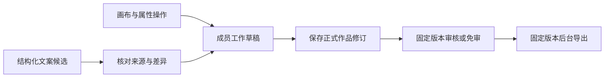

# 图文日常创作开发与验收

日期：2026-10-30。用户在[后续路线图](06-后续完善路线图.md)和[实施清单](07-下一阶段实施清单.md)之后明确授权继续开发。本批落实阶段A，承接[图文首版验收](../127-企业品牌内容工作台开发与验收.md)，继续使用现有平台、`content`应用、统一UI与现有Worker。

本批完成本地开发、隔离数据库/浏览器/Linux容器与恢复验证；没有生产发布、默认开通企业或新增付费模型调用。真实品牌资料和客户试点验收仍未取得。批量生产、企业治理与短视频继续按阶段B—D建设。

## 已交付能力

| 工作包 | 本批结果 |
| --- | --- |
| A01 质量复核 | 统一画面图层与交付文字稿；补草稿/采用/导出幂等、版本校验、私有素材下载复核及集合完整读取；不能用旧批准状态替代新修订审核 |
| A02 模块边界 | 拆出作品编辑、交付服务，画布、编辑器、状态和公共界面辅助；平台拥有媒体渠道配置，原应用门面继续兼容既有内部调用 |
| A03 画布操作 | 拖动、缩放手柄、键盘微调、对齐、图层顺序、图片裁剪、预览缩放、锁定保护；属性面板与画布共用操作状态 |
| A04 工作草稿 | 按企业/成员/作品保存工作草稿；自动同步、标签页缓存、重连同步、刷新恢复、撤销重做；冲突时保留输入并逐项比较采用 |
| A05 排版 | 浏览器使用服务端同源文字栅格预览，测量和导出共用附带授权的Noto字体；显示文字溢出/图层越界，阻止不完整文件交付；可切换三种尺寸并继续调整 |
| A06 文案建议 | 复用公共助手，携带当前作品引用进入文案建议，需求使用业务名称；结构化候选、差异查看、采用到草稿；绑定作品/项目/草稿快照，保留规格与数字事实，采用不再次调用模型 |
| A07 任务交付 | 固定版本的持久导出任务、独立Worker通道、租约/心跳恢复、重新打包、完成通知；作品/版本/批次/导出/用量/回收站分页，作品检索及私有缩略图 |
| A08 媒体渠道 | 平台持有渠道用途、端点、型号、凭据引用、能力和配置版本；复用现有环境凭据，队列派发核对绑定，已保存结果可跨配置变更恢复 |
| A09 验收 | 工程与隔离演练通过；真实品牌采用价值和生产发布独立待完成 |

直接改标题、价格、日期、位置、裁剪和版式不触发图片模型。预览缩放只改变查看比例。保存正式版本后，仍按企业策略执行送审或明确免审交付。

## 草稿、建议与版本

`ContentWorkDraft`保存成员、作品、基础正式版本、项目版本、草稿修订号、请求键和结构化状态。服务器使用并发校验；浏览器缓存按企业、成员、作品和基础版本隔离，只存资源引用。缓存位于当前标签页的`sessionStorage`，服务器已同步草稿可跨标签页恢复；未同步修改的标签页被彻底关闭后，不承诺找回其缓存。

一个拖拽或一次属性编辑形成可撤销操作，历史有数量上限，不记录图片Base64。中文输入和表单里的常用快捷键保持正常。历史版本以查看、对比为主，新的修改从当前版本与明确的草稿合并产生。

发生冲突后，比较窗口显示服务器内容与当前编辑的属性差异，由成员勾选采用；服务端再次校验目标版本、草稿修订、锁定和素材权限。未选择的属性保留服务器内容。正式保存后清理该成员工作草稿，并产生新的`draft`修订；其他成员的草稿继续接受过期检查。

`ContentCopySuggestion`保存候选及其来源指纹。助手先调用`inspect_artwork`核对该成员草稿与事实，再通过`stage_copy`工作单保存最多5个候选，创作者返回作品逐项采用。入口预填三个标题的需求，用户可以在公共助手中调整数量、字段或语气；打开助手不自动发送。

采用候选是确定性草稿写入。作品、项目或草稿已改变时拒绝旧建议；不得借候选修改价格、日期、规格和声明。数字与规格检查只是程序边界，文案中的资质、承诺及商业表述仍需人员核对。

## 排版与交付

附带`NotoSansCJKsc-Regular.otf`及完整OFL许可，来源、授权和校验值见[字体记录](../../apps/api/src/modules/content/fonts/README.md)。排版版本为`content-noto-sc-v1`。同一服务端函数负责断行、文字图层预览、尺寸测量和导出，不依赖浏览器安装字体；字体缺失时返回错误。

文字超出图层或图层超出画布时，编辑区指出对应图层。工作草稿可以继续调整，正式交付阻止静默截字。三种尺寸沿归一化坐标适配；复杂内容感知重排、品牌最小字号体系和完整模板变量按阶段B继续完善。

文字稿从可见文字图层生成，不保留另一份可独立偏离画面的正文。旧历史数据若已存在文字稿不一致，导出任务失败并提示保存修正版本。

导出请求固定作品版本、格式、草稿标记和请求键，创建`queued`任务后立即返回。Worker重新检查项目、版本审核与素材访问，经过`preparing`进入`ready`或明确失败。每个任务持有租约、心跳和独立临时文件；失去租约的执行不能发布最终结果。关闭页面后可在交付页取件或通过站内通知返回。

失败/过期重新打包不重新生成图片。下载仍复核当前对象与素材权限、审核状态和有效期。接口支持60个选择项的打包及对应单张读取，完整集合通过分页获取。未带`page`的旧作品/批次/导出/回收站读取保留原数组模式及其旧上限，不能将该模式用于全量处理；新界面与助手使用分页接口。

## 平台与数据变化

| 归属 | 变更 |
| --- | --- |
| 内容服务 | [编辑服务](../../apps/api/src/modules/content/content-artwork.service.ts)、[交付服务](../../apps/api/src/modules/content/content-delivery.service.ts)由[原门面](../../apps/api/src/modules/content/content.service.ts)调用；授权、审计、幂等和事务继续使用平台边界 |
| 前端 | [编辑器](../../apps/web/src/content/ArtifactEditor.tsx)、[画布](../../apps/web/src/content/ArtworkPreview.tsx)、[编辑与草稿状态](../../apps/web/src/content/editor-state.ts)、上下文与公共辅助从原页面拆出 |
| AI | 新增作品/任务分页读取、作品快照读取和候选工作单；文案预填沿公共[AiConversation](../../packages/frontend/src/AiConversation.tsx)，其他应用保持原入口 |
| 媒体技术配置 | [平台媒体渠道](../../apps/api/src/modules/platform/media-channel.ts)与[Seedream适配](../../apps/api/src/modules/content/seedream.provider.ts)；不新增前端Key表单或另一套配置中心 |
| 数据库 | 新增`ContentWorkDraft`、`ContentCopySuggestion`；为`ContentExport`增加执行人、租约、心跳和错误字段 |
| Worker | 新增`content_exports`通道，生成与导出分开执行；保留原应用通道 |

本批两条迁移为`20261030140000_content_daily_creation`和`20261030141000_content_copy_index`。先备份，再在专用QA数据库应用；旧QA备份恢复副本中也验证升级，原项目/作品/版本/素材计数保持。

媒体配置默认继续使用`Doubao-Seedream-4.5`，凭据引用按`CONTENT_ARK_API_KEY`、`BOM_VISION_API_KEY`、`ARK_API_KEY`查找。改变凭据账户或渠道能力时同步调整`CONTENT_MEDIA_CONFIG_VERSION`。派发前发现绑定改变则停止并要求重新预览；已有响应文件的恢复读取原结果，保留原有用量与账单待核对状态。媒体计量没有套用文本助手试用次数。

金额估算、预算预占和账单导入继续按阶段C实施；本批不把未知费用记为0。视频仍按既定Seedance型号后续验收，没有在本批调用或接入。

## 验收证据

环境：macOS本地Node 24.22.1，独立PostgreSQL `127.0.0.1:54329/suite_phase1_qa`；浏览器4631（开发服务及最终构建产物预览，私有路由按`app.html`入口转发），隔离Linux API 4651、Worker 4652。Linux镜像Node 24.21.0。全部业务测试使用专用假数据企业，旧本地/线上业务未切换到这套环境。

| 检查 | 结果 |
| --- | --- |
| 内容领域与HTTP闭环 | 143项通过，含多尺寸、权限隔离、审核与生成恢复 |
| 日常创作扩展 | 76项通过，含草稿、并发保存、冲突合并、候选采用、配置变更后的结果恢复与导出幂等 |
| 媒体HTTP适配 | 22项通过，3次本地替身HTTP请求，校验绑定、请求字段及拒绝/未知分类 |
| 媒体合成 | macOS与Linux各22项通过，PNG/JPEG/透明PNG和局部区域外不变 |
| 排版与裁剪 | macOS与Linux各15项通过，同一文字图层的预览/导出像素一致、裁剪比例保持、溢出拒绝 |
| 公共AI链路 | 26项通过，3次本地Runtime替身HTTP，候选确认与采用、生成确认防重及范围撤销 |
| Linux API/Worker | 23项通过，持久草稿、分页、同源排版、缩略图、异步导出、下载及Worker通道 |
| 前端与类型 | 工作区构建、两管理端类型检查通过；既有大包构建提示保留 |
| 其他应用回归 | ERP 114项HTTP；CRM统一业务110项HTTP；MES 39断言/136项HTTP通过 |
| 恢复 | 旧备份副本升级保留既有计数；新备份恢复后目标企业1草稿、1候选、8作品修订、2导出一致，7份媒体文件SHA一致；未替换在用数据库 |

内容六组检查合计304项；Linux、其他应用和浏览器证据分别列示，不混作真实模型或客户品牌验收。

浏览器实际操作覆盖：拖拽、缩放及整步撤销、键盘微调、锁定保护、刷新恢复、断网重连、服务端已提交但响应丢失后的撤销恢复、两个标签页冲突后逐项采用、校验失败后修正保存、候选差异与采用、保存新正式版本、后台打包下载，以及公共助手预填/返回当前作品。1440、1280、1024、900、768、390、320px七档宽度无文档横向溢出。

本批真实付费模型调用为0。此前首版3次Seedream真实验证及费用待对账的边界仍见[首版记录](../127-企业品牌内容工作台开发与验收.md)，不计入本批新增测试。

## 本地交付与后续

本地QA镜像：`enterprise-ai-platform/api:content-daily-local-20261030`，ID `sha256:20b02739ae1a5948f4731dafd8530b1281c93d72b96518f587f6318cbf75897e`。由已验证的后端产物叠加既有Linux基础镜像构建，内含本批迁移、媒体处理与授权字体；不代表生产已发布。

界面证据：[桌面](../../output/playwright/content-stage-a-20261030/workbench-desktop.png)、[手机](../../output/playwright/content-stage-a-20261030/workbench-mobile.png)、[交付完成](../../output/playwright/content-stage-a-20261030/delivery-ready.png)、[冲突处理后恢复](../../output/playwright/content-stage-a-20261030/conflict-recovered.png)。截图和下载包使用模拟品牌资料。

本批不覆盖真实品牌客户采用效果、大企业并发渲染容量、完整可访问性、生产发布和真实金额账单核对。首次生产发布应先备份数据库与私有媒体，仅应用本模块迁移；本地全库schema差异中既有MES人工约束等不应被误作本批要删除的对象。

下一批按阶段B推进产品资料导入、素材检索和标签、品牌模板变量、多尺寸批量操作与先选样后展开；之后再推进企业协作/成本治理及短视频。
